# AP creation procedure

This guide is for developers of Wi-Lab API clients. It describes how to reserve
an antenna and start an access point (AP) on it, which responses to expect, and
exactly when a request may be repeated. For the server internals behind each
step, see [Architecture](architecture.md).

All endpoints are under `/api/v2` and require `Authorization: Bearer <token>`.
Every error body has the same envelope:

```json
{"detail": {"code": 1006, "reason": "device_busy", "message": "optional text"}}
```

Use the HTTP status and `detail.code` for control flow. `detail.message` is for
display only and can change between versions.

Every answer leads to **one of six actions** (done, wait, repeat, fix, reserve
again, stop). The complete list, for every call, is in
[3.1 What to do with each answer](#31-what-to-do-with-each-answer); radio
failures such as a hostapd crash are explained in
[3.2](#32-radio-failures-such-as-a-hostapd-crash).
Every error code, with its HTTP status and action, is also listed in
[Error codes](error-codes.md).

Request bodies take only the JSON types they document: a number sent as a
string (`"6"`), `true` for a number, or a number for a boolean is a `422`.

**Not stable in 4.1:**

- **TX power** (`GET`/`POST /access-point/{reservation_id}/tx-power`, and `radio.tx_power_level` beyond its
  validation) is under debugging: the drivers in use do not apply the requested
  power reliably, so a change may answer `422` or report another level. The
  field of `POST /access-point/{reservation_id}/tx-power` is `tx_power_level`, as in the create.
- **QoS profiles** ([QoS](qos.md)) are experimental and untested.

Both may change in any release: do not build client logic on them.

## 1. Reservation

An AP always runs on a reserved antenna. The reservation decides **which**
antenna you get and **how long** you may use it.

```http
POST /api/v2/reservations
Content-Type: application/json

{"duration_seconds": 600}
```

`duration_seconds: 0` asks for an unlimited reservation. It is accepted only
when the server allows it: `GET /api/v2/antennas` reports
`reservation_policy.allow_unlimited` (with `min_seconds` and `max_seconds`).
When it is `false`, `0` returns `422`.

To reserve a given antenna, add its `interface` (from `antennas[]` of `GET /api/v2/antennas`):

```json
{"duration_seconds": 600, "interface": "wlx7419f8176286"}
```

Without `interface` (or with `null`) the server picks the first free antenna.
With it, the server reserves that antenna or answers an error; it never gives
you another one. The answers below then concern that antenna only: `409 / 1005`
means it is reserved (`next_available_*` is the expiry of its reservation,
`null` if unlimited), `503 / 1002` and `503 / 1003` that it is being recovered
or quarantined. Leave `interface` out unless you need that antenna: you wait
less.

| Response | Meaning | Client action |
|---|---|---|
| `200` | Antenna reserved. Body has `reservation_id`, `interface`, `display_name`, `expires_at`, `expires_in`. | Keep `reservation_id`: every following call uses it. |
| `409 / 1005` | All antennas are reserved (an antenna whose cleanup failed counts as reserved until the server's next cleanup attempt). `detail.next_available_at` is the estimated availability in UTC; `detail.next_available_in` is the wait in seconds. Both are `null` when no release is scheduled. | Retry later with backoff, or wait for an unlimited reservation to be released. |
| `503 / 1002` + `Retry-After: 10` | No antenna can be assigned while an antenna is being recovered. | Retry **the reservation** after `Retry-After`. This is a polling interval, not a promise. |
| `503 / 1003` | No antenna has been discovered yet, or none is usable and recovery is not running. | If the pool is empty at startup, allow discovery time and check `/status` before reserving again. If antennas remain unavailable, ask an operator to investigate. |
| `422` | `duration_seconds` is outside the server limits, or `0` while unlimited reservations are disabled; or `interface` is not a managed antenna. | Fix the request. |

Rules that matter for the AP:

- The AP lives only as long as the reservation. Creating or restarting an AP
  **never extends** `expires_at`. When the reservation expires, Wi-Lab stops
  the AP and frees the antenna.
- Reservation and network `expires_at` values use RFC 3339 UTC with a `Z`
  suffix (e.g. `2026-11-19T23:00:00Z`). They are `null` for unlimited
  reservations. `expires_in` is a countdown in seconds.
- Without `interface`, the server picks the antenna (the first free one).
- Release the reservation when you are done:
  `DELETE /api/v2/reservations/{reservation_id}`. This also stops the AP;
  a separate network stop is not required. **The release never fails**: `200`
  means the ID is gone. If the server cannot clean the antenna (for example
  hostapd stuck in the kernel), it keeps the antenna out of the pool and
  repeats the cleanup by itself; the client does nothing.
- `GET /api/v2/reservations/{reservation_id}` returns the remaining time.
  `404` means the ID is no longer valid; `detail.reason` says why
  (see [3.1](#31-what-to-do-with-each-answer)).

## 2. Creating the AP

### 2.1 Read what the antenna can use

The reservation answer names the antenna (`interface`). Ask what a network on
it can use; no reservation is needed, so a GUI can also show free antennas:

```http
GET /api/v2/antennas                              → antennas[]: interface, display_name, reservation
GET /api/v2/antennas/{interface}/capabilities     → encryptions, and per band the
                                                    Wi-Fi generations, widths and channels
```

The capabilities do not change while the adapter stays the same: read them once per
antenna. `GET /api/v2/antennas/{interface}` is the antenna now instead: where it is
attached, its entry of `antennas[]` in `GET /api/v2/antennas` (reservation, network, quarantine) and
its repair `health`.

```json
{
  "interface": "wlx7419f8176286",
  "encryptions": ["open", "wpa1", "wpa2", "wpa3", "wpa2-wpa3"],
  "bands": {
    "2.4ghz": {
      "wifi_generations": [
        {"wifi_generation": 4, "channel_widths": [20, 40]},
        {"wifi_generation": 6, "channel_widths": [20, 40]}
      ],
      "channels": [
        {"channel": 1, "frequency_mhz": 2412, "max_power_dbm": 20.0, "dfs": false, "channel_widths": [20, 40]}
      ]
    },
    "5ghz": {
      "wifi_generations": [
        {"wifi_generation": 4, "channel_widths": [20, 40]},
        {"wifi_generation": 5, "channel_widths": [20, 40, 80]},
        {"wifi_generation": 6, "channel_widths": [20, 40, 80]}
      ],
      "channels": [
        {"channel": 36, "frequency_mhz": 5180, "max_power_dbm": 23.0, "dfs": false, "channel_widths": [20, 40, 80]},
        {"channel": 165, "frequency_mhz": 5825, "max_power_dbm": 13.0, "dfs": false, "channel_widths": [20]}
      ]
    }
  }
}
```

Fill a form in this order: band, then a generation of that band, then one of
its `channel_widths`, then a channel whose `channel_widths` contains that
width. Every combination built this way is accepted by the create. The only
extra rule is `wpa1`: 802.11n (`wifi_generation` 4) at 20 MHz only.

- **Only usable channels are listed.** Channels disabled by the regulatory
  domain, No-IR channels and 6 GHz channels (reported by some Wi-Fi 6E
  antennas; Wi-Lab cannot create a 6 GHz network) are not in the list.
- **`device`** says where the antenna is attached: `bus` is `usb`, `pci` (also
  cards built into the motherboard) or `sdio`; `address` is the USB port
  (`2-1.3`) or the PCI address (`0000:02:00.0`); `driver` is the kernel driver.
  It is `null` when sysfs does not show the device.
- **DFS channels** (5 GHz 52–144, shared with radar) are listed, with
  `dfs: true`, only when the antenna has `show_dfs_channels: true` in `config.yaml`
  (`antennas[].show_dfs_channels`, required for every listed antenna; antennas not
  listed in the configuration behave as `true`). When `false` they are not
  listed and a create asking for one returns `422`. Before transmitting on a
  DFS channel the radio listens for radar (CAC), usually about 60 seconds;
  Wi-Lab's startup timeout for 5 GHz channels 52–144 is 75 seconds.
- **Weather-radar channels 120, 124 and 128** are never offered, also with
  `show_dfs_channels: true`: in Europe they need a 10-minute radar check before the AP
  may transmit. A create asking for one, or for a 40/80 MHz block that contains
  one, returns `422`.
- **`404`**: no managed antenna has this interface. **`503`**: the radio
  cannot be read now (unplugged or being reset); retry later.

### 2.2 Build the request

```http
POST /api/v2/access-point/{reservation_id}
Content-Type: application/json

{
  "radio": {
    "band": "2.4ghz",
    "channel": 6,
    "channel_width": 20,
    "wifi_generation": 4,
    "tx_power_level": 4
  },
  "wifi": {
    "ssid": "lab-test-01",
    "hidden": false,
    "security": {"encryption": "wpa2", "password": "testpass123"}
  },
  "internet": {"enabled": true},
  "captive_portal": {"enabled": false}
}
```

The body has the same sections as `GET /access-point/{reservation_id}`. Only `radio` and `wifi`
are required; `internet` and `captive_portal` can be omitted.

| Field | Required | Rules |
|---|---|---|
| `radio.band` | yes | `2.4ghz` or `5ghz`. An AP uses one band. |
| `radio.channel` | yes | Must be valid for `band` and supported and enabled on the antenna. |
| `radio.channel_width` | no | `20`, `40` or `80` MHz. Default `20`, the previous behavior. See [2.2.1](#221-encryption-channel-width-and-wi-fi-generation). |
| `radio.wifi_generation` | no | `4` (802.11n), `5` (802.11ac, 5 GHz only) or `6` (802.11ax). Default `4`, the previous behavior. |
| `radio.tx_power_level` | yes | `1` (low) to `4` (maximum). |
| `wifi.ssid` | yes | Network name: 1–32 bytes in UTF-8 (non-ASCII characters count as more than one byte), no control characters such as line breaks or tabs. |
| `wifi.hidden` | no | Default `false`. |
| `wifi.security.encryption` | yes | `open`, `wpa1`, `wpa2`, `wpa3` or `wpa2-wpa3`; see [2.2.1](#221-encryption-channel-width-and-wi-fi-generation). `wpa` is no longer accepted (`422`): use `wpa2`. |
| `wifi.security.password` | unless `open` | 8–63 bytes in UTF-8 for any WPA mode, no control characters. |
| `internet.enabled` | no | Default from the server configuration. Enables NAT to the upstream network. |
| `captive_portal.enabled` | no | Default `false`. Puts clients behind a simulated captive portal; see [2.7](#27-captive-portal). |

Validate the body on the client side when possible: an invalid body returns
`422` without touching the antenna. The message starts with the path of the
refused field, written with dots, for example `radio.channel_width: Input should
be 20, 40 or 80` or `wifi.security.password: wpa2 requires a password of 8 to 63
bytes (got 5)`. Rules between fields name the field they refuse (the password
for a short password, `radio.channel` for a channel outside the band,
`radio.channel_width` for a width the channel or the antenna cannot use), and
so do the antenna checks made before starting the AP.

#### 2.2.1 Encryption, channel width and Wi-Fi generation

Each antenna reports what it supports in `GET /api/v2/antennas/{interface}/capabilities`
(see [2.1](#21-read-what-the-antenna-can-use)), read from the radio (`iw phy`).
A create that asks for anything else returns `422` without touching the
antenna.

| `wifi.security.encryption` | What hostapd runs | Notes |
|---|---|---|
| `open` | No encryption. | |
| `wpa2` | WPA2-Personal: PSK, CCMP. | What `wpa` used to create. |
| `wpa3` | WPA3-Personal: SAE, PMF required. | SAE accepts both hunting-and-pecking and H2E. |
| `wpa2-wpa3` | Mixed mode: PSK and SAE, CCMP. | WPA3 clients must use PMF, WPA2 clients do not. |
| `wpa1` | Legacy WPA: PSK, TKIP. | Only to test legacy clients. Insecure; TKIP forbids 802.11n, so the network is 802.11a/g at 20 MHz, at most 54 Mbit/s. Some recent clients warn or refuse to connect. Accepted only on antennas that list it (the driver must support TKIP). |

`wpa` is no longer accepted: it silently created WPA2, so a client that wanted
to test WPA1 was actually testing WPA2. It returns `422` with a message that
points to `wpa2` (same network as before) or `wpa1` (real legacy WPA).

**Channel width and Wi-Fi generation** are optional; the defaults (20 MHz,
802.11n) are the behaviour before 4.0.0, so existing clients do not change.

- `radio.wifi_generation: 5` (802.11ac) exists only on 5 GHz.
  `radio.channel_width: 80` exists only on 5 GHz and needs `wifi_generation` 5
  or 6. With `wpa1` only
  20 MHz and generation 4 are accepted.
- On 5 GHz a wide channel is a fixed block of 20 MHz channels: at 40 MHz
  36+40, 44+48, 52+56, ..., at 80 MHz 36–48, 52–64, 100–112, 116–128,
  132–144, 149–161, 165–177. `channel` is the primary channel inside the block.
  **Every channel of the block** must be enabled on the antenna: 165 at 80 MHz
  usually returns `422` because 169–177 are not allowed, and a block with DFS
  channels follows the antenna's `show_dfs_channels`.
- On 2.4 GHz `channel_width: 40` is accepted: the second channel is 4 above
  (or 4 below when above is not available). It occupies most of the band, and
  hostapd falls back to 20 MHz when it sees neighbouring networks (20/40
  coexistence), which is common with several APs on. `GET /access-point/{reservation_id}` reports
  the width the radio actually uses in `radio.channel_width.reported`.
- `wifi_generation: 6` (802.11ax) is accepted where the antenna supports
  802.11ax in AP mode. On 5 GHz it is announced together with 802.11ac.

### 2.3 Send it, then poll

The create is **asynchronous**. `POST /access-point/{reservation_id}` checks the request and
answers at once; the AP starts in the background, and the client reads the
outcome with `GET /access-point/{reservation_id}`:

1. `POST /access-point/{reservation_id}` answers `202` with the network in
   `"runtime_state": "starting"`, `"active": false`. The body has the same
   schema as `GET /access-point/{reservation_id}` (a client library that sees only the body
   decides from `active` and `runtime_state`).
2. Read `GET /access-point/{reservation_id}` every 1–2 s while `runtime_state` is `starting`. It
   answers at once, even while the antenna is busy with the start.
3. Stop at the first outcome (2.4).

A start normally takes about 0.5 s, so the first read often already shows the
AP. If the radio fails (for example a hostapd crash), Wi-Lab rolls the start
back and starts again by itself, still in `starting`: up to 3 starts 1 s apart,
then one more after a 5 s pause and a last one after a 10 s pause.
**The client does nothing during these starts.** Expected time to the outcome:

| Channel | Usual | Worst case |
|---|---|---|
| 2.4 GHz and non-DFS 5 GHz | 0.5–6 s | about 80 s |
| DFS 5 GHz (52–144) | about 60 s (radar check) | about 7 min |

Every request is short, so normal HTTP timeouts (10–30 s) are enough. You may
not see every intermediate state: a state is what the server is doing at the
moment of the read. There is no percentage of progress: the duration is not
predictable.

**Send only one create at a time per reservation.** The same body again is
safe (see 2.5); another body while a start runs answers `409 / 1008`.

### 2.4 Handle the answer and the outcome

The actions for every call, in one place, are in [3.1](#31-what-to-do-with-each-answer).

**Answers of the `POST`:**

| Response | Meaning | Client action |
|---|---|---|
| `202` | Start accepted (also the same body while that start runs). | Poll `GET /access-point/{reservation_id}`. |
| `200` | The same body on a network that already runs with exactly these settings: the network. Nothing was restarted. | Done. |
| `409 / 1008` (`access_point_already_active`) | A network with **different** settings runs or is starting on this reservation. | Read it with `GET /access-point/{reservation_id}`; `DELETE /access-point/{reservation_id}` first to replace it. |
| `409 / 1012` (`stop_incomplete`) | The last `DELETE /access-point/{reservation_id}` did not complete (`runtime_state: stop_failed`). | Repeat `DELETE /access-point/{reservation_id}` until `200`, then the create. |
| `409 / 1009` (`restoration_in_progress`) | The watchdog is repairing this network (`restoring_ap`, `restoring_dhcp`, `dhcp_failed`). | Do not create. Poll `GET /access-point/{reservation_id}` until `runtime_state` is `null`. |
| `422` | Invalid body (including `encryption: wpa`), channel unsupported/disabled on this antenna, or an encryption, channel width or Wi-Fi generation the antenna does not support. | Fix the request. Do not repeat the same body. |
| `404` | The reservation ID is no longer valid; `detail.reason` says why. | See 3.1. |
| `401` | Missing or invalid token. | Fix the token. |

**Outcomes of the polling (`GET /access-point/{reservation_id}`):**

| Answer | Meaning | Client action |
|---|---|---|
| `200`, `active: true`, `runtime_state: null` | The AP is up and DHCP is running. | Done. |
| `200`, `runtime_state: "start_failed"`, `error` | A non-radio startup error: `error.code` `1013`, `error.stage` says what failed (`hostapd` e.g. exit code 1, `interface`, `gateway`, `dhcp`, `captive_portal`, `nat`, `internet_block`, `isolation`, `host_guard`), `error.message` for display. The start was rolled back and the reservation is **still valid**. `start_failed` stays until a new create, a `DELETE /access-point/{reservation_id}` or the end of the reservation. | No automatic retry (it is usually a configuration or host problem). Show the message. A new create starts again; release the ID if you give up. |
| `404`, `detail.reason: reservation_invalidated` | **Every start failed**: the antenna was quarantined and the reservation invalidated. | Reserve again (you will get another antenna). **Do not release** the old ID. |
| `404`, `detail.reason: reservation_expired` | The reservation expired, also when it would have expired before the next start. | Reserve again if needed. |

A `restoring_*` state never appears between `starting` and the outcome: the
watchdog takes over a network only after its start completed.

### 2.5 When and how to repeat

**No outcome authorizes an automatic retry.** Radio failures are retried by
the server during the start (2.3); the client never repeats a create because
of them. Further rules:

- **Reuse the same ID.** A new reservation while this one is held leaves this
  antenna held until it expires.
- **After a transport error, send the same create again, or just poll.** The
  same body never starts a second AP: `202` while that start runs, `200` once
  it runs. Then handle the answer as usual.
- **Stopping or releasing during a start cancels it.** `DELETE /access-point/{reservation_id}`
  cancels the start and keeps the reservation; `DELETE /reservations/{id}`
  cancels it and releases. Both answer within seconds, also during a long DFS
  start.
- **Other calls during a start** (Internet, TX power, QoS) answer
  `503 / 1006`: wait for the outcome first.

### 2.6 After the AP is running

- **No network: `409 / 1007`.** Internet, TX power and QoS profile requests
  on a valid reservation that has no running network return `409` with
  `detail.code: 1007` (`access_point_not_active`). Create a network first. A `404`
  on these endpoints always means the reservation itself is unknown, expired
  or invalidated.
- **Half-stopped network: `409 / 1012`.** After a `DELETE /access-point/{reservation_id}` that
  answered `503 / 1012` (`runtime_state: stop_failed`), Internet, TX power and
  QoS profile requests return `409` with `detail.code: 1012`
  (`stop_incomplete`): repeat the DELETE until `200`.
- **Adapter busy: `503 / 1006`.** Every request on a reservation except the
  release (`GET`/`DELETE /access-point/{reservation_id}`, Internet, TX power, QoS profile, and
  the create in one case below) waits at most **5 s** for another operation on the
  same adapter, such as a network start (for its duration see
  [2.3](#23-send-it-then-poll)) or a stop that the server is repeating.
  After that it returns `503` with `detail.code: 1006`,
  `reason: device_busy` and `Retry-After: 2`. Nothing was changed: repeat the
  same request after `Retry-After`. A create that starts a network never
  returns `1006`: it answers `202` at once and the start, in the background,
  waits for the adapter. Only the same body sent again on a network already
  running (the `200` answer) reads the network like `GET /access-point/{reservation_id}` and can
  return `1006`. During a start `GET /access-point/{reservation_id}` answers at once, and the
  release never returns `1006`.

  ```json
  HTTP/1.1 503 Service Unavailable
  Retry-After: 2

  {"detail": {"code": 1006, "reason": "device_busy",
              "message": "Another operation on this adapter is still running; retry after Retry-After"}}
  ```

- `GET /api/v2/access-point/{reservation_id}` returns the network in
  sections:

  ```json
  {
    "interface": "wlx7419f8176286", "active": true, "runtime_state": null,
    "reservation": {"expires_at": "2026-11-19T23:00:00Z", "expires_in": 3471},
    "restarts": {"ap": 0, "dhcp": 0, "last_at": null, "last_reason": null},
    "error": null,
    "radio": {
      "band": "5ghz", "channel": 36,
      "channel_width": {"requested": 80, "reported": 80},
      "wifi_generation": 5,
      "tx_power": {"requested_level": 4, "reported_level": 4, "reported_dbm": 20.0}
    },
    "wifi": {"ssid": "lab-test-01", "hidden": false,
             "security": {"encryption": "wpa2", "password": "testpass123"}},
    "ip": {"subnet": "192.168.120.0/24", "gateway": "192.168.120.1",
           "dhcp_range": {"start": "192.168.120.10", "end": "192.168.120.250"},
           "dns_server": "192.168.10.21"},
    "internet": {"enabled": true},
    "captive_portal": {"enabled": false, "url": null},
    "clients": [{"mac": "aa:bb:cc:dd:ee:01", "ip": "192.168.120.10"}]
  }
  ```

  | Section | Content |
  |---|---|
  | `reservation` | `expires_at` (UTC) and `expires_in` (seconds); always present. |
  | `restarts` | Watchdog repairs counted over the reservation (see below); always present. |
  | `error` | Set only with `runtime_state: start_failed` (2.4); `null` otherwise. |
  | `radio` | Band, channel, channel width (`requested`, and `reported` by the radio: lower when hostapd fell back to 20 MHz on 2.4 GHz), Wi-Fi generation, TX power. |
  | `wifi` | SSID, hidden flag, `security` (encryption and password, returned so test devices can be connected). |
  | `ip` | Subnet, gateway, DHCP range and the DNS server announced to clients. |
  | `internet`, `captive_portal` | Whether NAT is enabled; whether the portal is on, and its URL. |
  | `clients` | Connected clients (`mac`, `ip`, and `captive_authorized` with a portal). The count is the list length. |

  While the network is not running, or while the watchdog restores it, only
  `interface`, `active`, `runtime_state`, `reservation` and `restarts` are
  set; the other sections are `null`.
- Wi-Lab's watchdog checks every running AP about every 5 seconds and restarts
  it with the same settings and reservation, up to 3 times per hour per
  antenna; a fourth failure within the hour quarantines the antenna. While this
  happens, `GET /access-point/{reservation_id}` and `GET /api/v2/status` report `runtime_state`:

  | `runtime_state` | Meaning | Client action |
  |---|---|---|
  | `starting` | A create is running (2.3). | Poll until the outcome. |
  | `start_failed` | The last create failed for a non-radio reason; see `error` (2.4). | A new create, or `DELETE /access-point/{reservation_id}` to clear it. |
  | `restoring_ap` | The AP is being restarted. Clients will need to reconnect. | Wait. Do not send a create. |
  | `restoring_dhcp` | Only DHCP is being restarted. The AP stays up. | Wait. |
  | `dhcp_failed` | DHCP could not be repaired alone (a restart failed, or dnsmasq died more than 3 times in an hour). Within 5 s the watchdog restarts the whole network (`restoring_ap`). | Wait. |
  | `restore_failed` | The AP restart failed for a non-radio reason (also a cleanup that failed once). The AP is down (`active: false`); the watchdog retries after 15 s, 30 s, 60 s, 120 s, then every 5 minutes while the reservation is valid. | Wait for `runtime_state` to clear, or `DELETE /access-point/{reservation_id}` to stop the retries (the reservation stays valid), or create a new network. |
  | `stop_failed` | After a `DELETE /access-point/{reservation_id}` answered `503 / 1012` (also in `GET /status`). Only the owner's stop sets it: a failed expiry, rollback or background cleanup is retried by the server and shows as `cleanup_failed`: the stop did not complete, usually because hostapd stayed stuck in the kernel for a few seconds after a driver firmware timeout. The network is half stopped and the watchdog leaves it alone. | Repeat `DELETE /access-point/{reservation_id}` after `Retry-After` (5 s). |

- An AP restart clears traffic shaping and QoS profiles: reapply them after a
  `restoring_ap` phase.
- **You do not need to poll `runtime_state` all the time.** A repair that
  starts and ends between two reads leaves `runtime_state` at `null`, but
  `GET /access-point/{reservation_id}` always has a `restarts` section that counts the repairs
  over the whole reservation (it never decreases, also when you recreate the
  network):

  ```json
  "restarts": {"ap": 1, "dhcp": 0, "last_at": "2026-11-25T22:40:12Z", "last_reason": "hostapd_not_running"}
  ```

  Read it before and after a test: if `restarts.ap` grew, the AP was down for
  a moment (devices disconnected, QoS profiles and captive portal sign-ins
  lost) and the test may need to be repeated. `restarts.dhcp` counts DHCP-only
  repairs, during which the AP stayed up. `last_reason` is
  `hostapd_not_running`, `hostapd_not_enabled`, `dnsmasq_not_running`,
  `dhcp_failed` or `network_check_failed`.
- If the restart fails because of the radio (including a hostapd crash on
  every internal start), or the AP fails more than 3 times in an hour, the
  antenna is quarantined and the reservation is invalidated **at once**, with
  no notification. The next call
  with the ID returns `404`: reserve again (see
  [3.2](#32-radio-failures-such-as-a-hostapd-crash)). If the restart fails for
  another reason, the reservation stays valid and `runtime_state` is
  `restore_failed` until a retry succeeds.
- `GET /api/v2/status` reports `recovery_state` (`recovering` or `unavailable`)
  for quarantined antennas. They can show `reservation: null` but are **not**
  allocatable.
- To stop the AP but keep the antenna: `DELETE /access-point/{reservation_id}`. To finish: release
  the reservation.

### 2.7 Captive portal

With `"captive_portal": {"enabled": true}`, each client that joins the AP is held behind a
simple portal until it signs in. Use it to check how a device detects a
captive network. Without the flag, nothing changes.

Until the client signs in:

- DNS queries are answered by the AP with the gateway address, so connectivity
  checks resolve and reach the portal even when `internet.enabled` is `false`.
- HTTP requests on port 80, to any host, are redirected (`302`) to the portal
  page, `http://<gateway>:8081/` (the port is `captive_portal_port` in the
  server configuration; `captive_portal.url` gives the exact address).
- Any other forwarded traffic, including HTTPS, is rejected.

The page, titled **WiLab Captive Portal**, shows the SSID, band and channel,
subnet, gateway, DHCP range, the client's IP and MAC address, whether the
network has Internet access, and when the network expires. Its **Sign in**
button releases only the client that pressed it, identified by its MAC and IP
address. Other clients stay on the portal. There is no API to sign a client
in.

After sign-in, the client uses the DNS server from the configuration and the
network's normal Internet setting: with `internet.enabled: false` it stays
offline. `GET /access-point/{reservation_id}` reports `captive_portal.enabled`, `captive_portal.url`
and, for each client, `captive_authorized`.

Notes:

- Clients are detected through their HTTP connectivity checks. Wi-Lab does not
  advertise the portal via DHCP option 114 (RFC 8910) and does not intercept
  HTTPS.
- A client that obtains a new IP address, or changes its MAC address, must
  sign in again. Sign-ins are cleared when the AP stops, the reservation ends
  or the watchdog restarts the AP.
- The portal listens on `captive_portal_port` (8081 in the example configuration) and dnsmasq
  answers DNS on port 53, both on the AP gateway address only. Every AP uses
  its own gateway address, so several captive APs can run at the same time.

### 2.8 Service health: `degraded` and quarantined antennas

The client must check `GET /api/v2/status` to know whether every antenna is
usable. Poll it (for example every 10–30 s) and show the result to the user.

`service` is the state of Wi-Lab:

| Field | Value | Meaning |
|---|---|---|
| `health` | `good` | Every health check passes. |
| `health` | `degraded` | At least one entry in `degraded_reasons`. |
| `degraded_reasons` | list | Why `health` is `degraded`; empty when `good`. |
| `free_antennas` | `N` | Antennas a reservation would get now: not reserved, not quarantined, not held by a failed cleanup. `0`: a reserve answers `409 / 1005` or `503 / 1002`, `1003`. |
| `restart_required` | `null` or object | Security updates on the host that need a restart of Wi-Lab or a reboot; never done automatically and never `degraded`. Always present. |

`free_antennas` is a hint for a dashboard or a queue: to get an antenna, reserve
it (`POST /api/v2/reservations`), since another client may take the last free one
in between.

`degraded_reasons` says why, with a stable `code` and the `interface` it
concerns (`null` for the whole service). `GET /api/v2/antennas` gives the state
of each antenna, the same `free_antennas` and `reservation_policy`:

```json
GET /api/v2/status
{
  "version": "4.1.0",
  "service": {
    "health": "degraded",
    "free_antennas": 0,
    "degraded_reasons": [
      {"code": "antenna_quarantined", "interface": "wlx7419f8176286",
       "message": "Antenna quarantined (unavailable)"}
    ],
    "restart_required": null
  },
  "checked_at": "2026-11-19T22:51:00Z",
  "check_interval_seconds": 10,
  "checks": {"...": "the detail of every check"}
}

GET /api/v2/antennas
{
  "free_antennas": 0,
  "reservation_policy": {"min_seconds": 60, "max_seconds": 86400, "allow_unlimited": false},
  "antennas": [
    {"interface": "wlx7419f8176286", "display_name": "antenna-1", "reservation": null,
     "access_point_active": false, "recovery_state": "unavailable"},
    {"interface": "wlx7419f817651c", "display_name": "antenna-2",
     "reservation": {"expires_at": "2026-11-19T23:00:00Z", "expires_in": 540},
     "access_point_active": true}
  ]
}
```

| `service.degraded_reasons[].code` | Meaning | Client action |
|---|---|---|
| `antenna_quarantined` | The antenna has `recovery_state`: `recovering` (Wi-Lab is resetting and probing it) or `unavailable` (no USB reset running; re-probed after 30 s, backing off to every 15 min). | Do not count it as available. It may return by itself; report it if `unavailable` persists. |
| `access_point_being_repaired` | A reserved AP has `runtime_state`: `restoring_ap`, `restoring_dhcp`, `dhcp_failed` (whole network restarted within 5 s) or `restore_failed` (AP down, retried with backoff). See [2.6](#26-after-the-ap-is-running). | Owner: wait (or `DELETE /access-point/{reservation_id}` on `restore_failed`). Others: nothing to do. |
| `access_point_stop_incomplete` | A `DELETE /access-point/{reservation_id}` on that antenna answered `503 / 1012`: the network is half stopped (`runtime_state: stop_failed`). | Its owner repeats the DELETE; others do nothing. |
| `hostapd_not_running`, `dnsmasq_not_running` | The AP or DHCP process of that network is not alive. | Report it; the watchdog normally repairs it within seconds. |
| `nat_rule_missing` | That network has Internet enabled but lost its NAT rule. | Report it; Internet does not work there until the watchdog repairs it. |
| `command_stuck` | A host command (`ip`, `iw`, `usbreset`, ...) did not exit even after SIGKILL: usually a hung Wi-Fi driver. Set also when no antenna is reserved. | Report it: the adapter may need a reset or the host a reboot. |
| `loop_stalled` | A Wi-Lab background loop has not run for 3 minutes. Wi-Lab restarts itself as soon as no reservation is active. | Report it; release reservations you no longer need. |
| `cleanup_failed` | The cleanup after a release or expiry failed (for example hostapd stuck in the kernel). The antenna is held, not reservable; Wi-Lab repeats the cleanup after 5 s, 15 s, 60 s, then every 5 minutes. | Nothing: reserve another antenna, or wait. If it persists, an operator checks the host. |

The checks that run host commands are refreshed every 10 s in the background,
so a problem can take up to 10 s to appear. The detail of every check
(processes, NAT rules, upstream link, OS updates, stuck commands, stalled loops,
time of the last check) is `checks` of `GET /api/v2/status`, for operators and
monitoring views; clients only need `service`.

- Each antenna has `reservation` (`null` when no reservation holds it;
  `{expires_at, expires_in}` otherwise, both `null` when unlimited) and
  `access_point_active` (a network runs on it).
- `reservation: null` does **not** mean the antenna can be reserved: an entry
  with `recovery_state` is excluded from allocation.
- How a client learns that *its* antenna was quarantined: every call with the
  reservation ID, including the polling of a create, returns `404` with
  `detail.reason: reservation_invalidated`. There is no other notification:
  discard the ID and reserve again.
- New reservations skip quarantined antennas silently while another antenna is
  free. When none is allocatable because of quarantine, reserve returns `503`
  with `1002` (recovery in progress, retry after `Retry-After`) or `1003`
  (nothing is recovering).

## 3. Sequence diagram

The whole client flow, from the reservation to the release, with every answer
a client must handle (the same answers, one action each, are listed in
[3.1](#31-what-to-do-with-each-answer)). `id` is the `reservation_id`; every call carries
`Authorization: Bearer <token>` (a `401` anywhere means a wrong token: fix it,
never retry). Phases 4 and 5 are optional; the release (phase 6) also stops the
AP.

```mermaid
sequenceDiagram
    autonumber
    participant C as Client
    participant W as Wi-Lab API

    rect rgba(128,128,128,0.08)
    Note over C,W: Phase 0 - before reserving (optional, no reservation needed)
    C->>W: GET /antennas
    W-->>C: free_antennas, reservation_policy, antennas[] (reservation, access_point_active, recovery_state)
    Note over C: allow_unlimited tells whether duration_seconds 0 is accepted.<br/>Entries with recovery_state are not allocatable.
    end

    rect rgba(128,128,128,0.08)
    Note over C,W: Phase 1 - reserve an antenna
    loop Until 200, or until the client gives up
        C->>W: POST /reservations {duration_seconds, interface (optional)}
        alt 200
            W-->>C: reservation_id, interface, display_name, expires_at, expires_in
            Note over C: Keep id and interface. Leave the loop
        else 409 / 1005 all antennas reserved (with interface: that antenna)
            W-->>C: next_available_at, next_available_in (null if no release is scheduled)
            Note over C: Automatic retry allowed: wait next_available_in<br/>(or a backoff of 10 to 60 s when null), then repeat
        else 503 / 1002 + Retry-After 10
            W-->>C: an antenna is being recovered, nothing allocatable now
            Note over C: Automatic retry allowed: wait Retry-After, then repeat
        else 503 / 1003
            W-->>C: no antenna discovered or usable, no recovery running
            Note over C: Right after a service start: wait for discovery (up to 30 s),<br/>check GET /status, then retry. With interface: that antenna is quarantined,<br/>reserve without interface. Otherwise stop and ask an operator
        else 422
            W-->>C: duration outside min/max, 0 while unlimited is off, or unknown interface
            Note over C: Fix the body. Never repeat the same body
        end
    end
    end

    rect rgba(128,128,128,0.08)
    Note over C,W: Phase 2 - read what the antenna can use (no reservation needed)
    C->>W: GET /antennas/{interface}/capabilities
    alt 200
        W-->>C: encryptions, bands: wifi_generations (widths) and usable channels (widths)
        Note over C: Build the body: band, then generation, then width,<br/>then a channel whose channel_widths contains that width.<br/>wpa1 only with wifi_generation 4 at 20 MHz
    else 503
        W-->>C: the radio cannot be read now (unplugged, being reset)
        Note over C: Retry after a few seconds, or create with the defaults (20 MHz, 802.11n)
    else 404
        W-->>C: no managed antenna has this interface
        Note over C: Should not happen with an interface from the reservation: reserve again
    end
    end

    rect rgba(128,128,128,0.08)
    Note over C,W: Phase 3 - create the AP (asynchronous: POST, then poll GET)
    C->>W: POST /access-point/{id} {radio, wifi, internet, captive_portal}
    alt 202 runtime_state starting
        W-->>C: accepted, same schema as GET /access-point/{reservation_id}
        Note over W: In the background: prepares the radio, starts hostapd, waits for the AP<br/>(10 s, 75 s on DFS), gateway, DHCP, NAT, isolation. Radio failure: up to<br/>3 starts 1 s apart, then one after 5 s, then one after 10 s
        loop every 1-2 s while runtime_state is starting
            C->>W: GET /access-point/{id}
            alt runtime_state starting
                W-->>C: still starting (answered at once)
            else active true, runtime_state null
                W-->>C: the network
                Note over C: Done. Leave the loop
            else runtime_state start_failed + error
                W-->>C: error.code 1013, error.stage, error.message, reservation still valid
                Note over C: No automatic retry. Show the message.<br/>A new create starts again, or release the id if you give up
            else 404 reason reservation_invalidated
                W-->>C: every start failed, antenna quarantined
                Note over C: Terminal. Do NOT release the id. Reserve again (phase 1)
            else 404 reason reservation_expired
                W-->>C: expired, also before the next start could run
                Note over C: Reserve again if needed
            end
        end
    else 200
        W-->>C: the same body on a network already running with it: the network
        Note over C: Done
    else 422
        W-->>C: message starts with the field path (radio.channel: ..., wifi.security.password: ...)
        Note over C: Fix that field. Never repeat the same body
    else 409 / 1008 access_point_already_active
        W-->>C: a network with different settings runs or is starting
        Note over C: Read it with GET /access-point/{reservation_id}, or DELETE /access-point/{reservation_id} first
    else 409 / 1012 stop_incomplete
        W-->>C: the last DELETE /access-point/{reservation_id} did not complete
        Note over C: Repeat DELETE /access-point/{reservation_id} until 200, then the create
    else 409 / 1009 restoration_in_progress
        W-->>C: the watchdog is repairing this AP
        Note over C: Do not create. Poll GET /access-point/{reservation_id} until runtime_state is null
    else 404
        W-->>C: the reservation id is no longer valid, detail.reason says why
        Note over C: invalidated or expired: reserve again. released or not_found: stop
    else transport error (no answer)
        Note over C: Send the SAME create again, or poll GET /access-point/{reservation_id}:<br/>the same body never starts a second AP
    end
    Note over C,W: DELETE /access-point/{reservation_id} or DELETE /reservations/{id} during starting cancels the start
    end

    rect rgba(128,128,128,0.08)
    Note over C,W: Phase 4 - while the AP is in use
    par Owner polls its network (every 5 to 30 s)
        C->>W: GET /access-point/{id}
        alt 200, runtime_state null
            W-->>C: active, radio, wifi, ip, internet, captive_portal, clients, reservation
        else 200, runtime_state restoring_ap
            W-->>C: active false, sections null: the AP is being restarted
            Note over C: Wait. Clients must reconnect. Reapply QoS profiles afterwards
        else 200, runtime_state restoring_dhcp or dhcp_failed
            W-->>C: DHCP is being repaired, the whole network restarts within 5 s if needed
            Note over C: Wait
        else 200, runtime_state restore_failed
            W-->>C: AP down, the watchdog retries (15 s, 30 s, 60 s, 120 s, then every 5 min)
            Note over C: Wait, or DELETE /access-point/{reservation_id} to stop the retries, or create again
        else 200, runtime_state stop_failed
            W-->>C: a previous stop did not complete
            Note over C: Repeat DELETE /access-point/{reservation_id} (phase 5)
        else 503 / 1006 + Retry-After 2
            W-->>C: another operation holds the antenna, nothing changed
            Note over C: Automatic retry allowed after Retry-After
        else 404
            W-->>C: expired, released or invalidated (quarantine)
            Note over C: The AP is gone. Reserve again if needed
        end
    and Anyone polls the service (every 10 to 30 s)
        C->>W: GET /status
        W-->>C: service {health, free_antennas, degraded_reasons, restart_required}, recovery_state, runtime_state
        Note over C: Show degraded with the affected antenna
    end
    opt Change the running network
        C->>W: POST /access-point/{reservation_id}/internet/enable or disable, POST /access-point/{reservation_id}/tx-power, POST or DELETE .../qos/profile
        alt 200
            W-->>C: applied
        else 409 / 1007
            W-->>C: no running network on this reservation
            Note over C: Create the network first
        else 503 / 1006 + Retry-After 2
            W-->>C: antenna busy, nothing changed
            Note over C: Automatic retry allowed after Retry-After
        else 404
            W-->>C: reservation gone
        end
    end
    end

    rect rgba(128,128,128,0.08)
    Note over C,W: Phase 5 - stop the AP and keep the reservation (optional)
    loop Until 200, 409 / 1007 or 404
        C->>W: DELETE /access-point/{id}
        alt 200
            W-->>C: stopped (also cancels the retries of restore_failed)
        else 409 / 1007
            W-->>C: already inactive
        else 503 / 1006 + Retry-After 2
            W-->>C: antenna busy, nothing changed
            Note over C: Automatic retry allowed after Retry-After
        else 503 / 1012 + Retry-After 5
            W-->>C: stop not completed even after 15 s of server retries, runtime_state stop_failed
            Note over C: Automatic retry allowed: repeat the DELETE after Retry-After.<br/>The watchdog leaves the half-stopped network alone
        else 404
            W-->>C: reservation gone (the AP was stopped with it)
        end
    end
    end

    rect rgba(128,128,128,0.08)
    Note over C,W: Phase 6 - release (also stops the AP), or let the reservation expire
    C->>W: DELETE /reservations/{id}
    alt 200
        W-->>C: released (always, even if the cleanup failed: then the server<br/>keeps the antenna out of the pool and repeats the cleanup by itself)
    else 404
        W-->>C: already expired, released or invalidated
        Note over C: Nothing to do
    end
    Note over W: At expires_at Wi-Lab stops the AP and frees the antenna without any call.<br/>Creating or restarting an AP never extends the reservation
    end
```



### 3.1 What to do with each answer

Every answer leads to exactly one of these actions:

| Action | Meaning |
|---|---|
| **DONE** | Success. Go on. |
| **WAIT** | The server is working on it. Send nothing that changes the network; read the state again (`GET /access-point/{reservation_id}`) every few seconds. |
| **REPEAT** | Send the **same** request again (same ID, same body) after `Retry-After`. Automatic retries are allowed only here. |
| **FIX** | The request is wrong. Change it; never resend the same one. |
| **RESERVE AGAIN** | The reservation ID is gone. Stop using it, **do not release it**, and reserve again (`POST /reservations`) if you still need an AP. You may get another antenna. |
| **STOP** | A problem the client cannot solve. Show `detail.message`, check `GET /status`, and ask an operator. No automatic retry. |

| Call | Answer | Action | Notes |
|---|---|---|---|
| any | `401` | FIX | Wrong or missing token. |
| any call with an ID | `404` + `reason: reservation_invalidated` or `reservation_expired` | RESERVE AGAIN | The ID was invalidated (its antenna was quarantined: radio failures, also during a watchdog restart) or expired. Never release it. On a release: DONE. |
| | `404` + `reason: reservation_released` or `reservation_not_found` | DONE | Released (by you or release-all), never existed, or ended more than an hour ago. Nothing to release. |
| `GET`/`DELETE /access-point/{reservation_id}`, Internet, TX power, QoS | `503 / 1006` + `Retry-After: 2` | REPEAT | Another operation holds the antenna. Nothing was changed. Never on the release; on the create see its row. |
| `POST /reservations` | `200` | DONE | Keep `reservation_id` and `interface`. |
| | `409 / 1005` | REPEAT | All antennas reserved (with `interface`: that one). Wait `next_available_in`, or a backoff of 10–60 s when it is `null`. |
| | `503 / 1002` + `Retry-After: 10` | REPEAT | An antenna is being recovered. |
| | `503 / 1003` | STOP | No usable antenna. Right after a service start, wait up to 30 s for discovery and check `GET /status` first. With `interface`: that antenna is quarantined; reserve without it. |
| | `422` | FIX | `duration_seconds` out of limits, `0` while unlimited reservations are off, or `interface: ...` not a managed antenna. |
| `GET /antennas/{interface}/capabilities` | `503` | REPEAT | After a few seconds; the radio is being reset. Or create with the defaults. |
| | `404` | RESERVE AGAIN | The antenna is no longer managed. |
| `POST /access-point/{reservation_id}` (create) | `202` | WAIT | Start accepted: poll `GET /access-point/{reservation_id}` every 1–2 s (rows below). |
| | `200` | DONE | The same body on a network already running with it: the network. |
| | `503 / 1006` + `Retry-After: 2` | REPEAT | Only for the same body on a running network: another operation holds the antenna. Nothing was changed. |
| | `422` | FIX | The message starts with the field path, e.g. `radio.channel_width: ...`. |
| | `409 / 1008` | FIX | A network with **different** settings runs or is starting (the same body answers `202` or `200`). Read it with `GET /access-point/{reservation_id}`; `DELETE /access-point/{reservation_id}` first to replace it. |
| | `409 / 1012` | REPEAT | The last `DELETE /access-point/{reservation_id}` did not complete: repeat it until `200`, then send the create again. |
| | `409 / 1009` | WAIT | Until `runtime_state` is `null`, then create only if `active` is `false`. |
| | `500 / 500` | STOP | An unexpected server error. |
| | no answer (timeout, connection lost) | REPEAT | Send the **same** create again, or poll `GET /access-point/{reservation_id}`: the same body never starts a second AP. |
| `GET /access-point/{reservation_id}` | `200`, `runtime_state: starting` | WAIT | A create is running; read again in 1–2 s. |
| | `200`, `runtime_state: start_failed` | STOP | Non-radio failure (`error.code` `1013`, `error.stage`, `error.message`), rolled back; the reservation is still valid. A new create starts again; release the ID if you give up. |
| | `200`, `runtime_state: null` | DONE | |
| | `200`, `restoring_ap`, `restoring_dhcp`, `dhcp_failed` | WAIT | The watchdog is repairing the network. After `restoring_ap`, devices reconnect and QoS profiles must be reapplied. |
| | `200`, `restore_failed` | WAIT | The AP is down and the watchdog retries. Or `DELETE /access-point/{reservation_id}` to give up, or create again. |
| | `200`, `stop_failed` | REPEAT | Repeat the `DELETE /access-point/{reservation_id}` that answered `503 / 1012`. |
| Internet, TX power, QoS | `409 / 1007` | FIX | No running network: create it first. |
| | `409 / 1012` | REPEAT | The last stop did not complete: repeat `DELETE /access-point/{reservation_id}` until `200`. |
| | `422` | FIX | Includes a TX power the driver does not support and an unknown QoS `profile_id`. |
| QoS profile start | `409 / 1010` | FIX | A profile already runs: stop it first. |
| QoS profile stop | `409 / 1011` | DONE | No profile runs. |
| `DELETE /access-point/{reservation_id}` | `200` | DONE | The reservation stays. |
| | `409 / 1007` | DONE | Already inactive. Also the normal end of a stop that answered `503 / 1006` because a start was slow to cancel (more than 30 s): repeat until `200` or `409 / 1007`; both mean stopped. |
| | `503 / 1012` + `Retry-After: 5` | REPEAT | The stop did not complete, even after the server repeated it for 15 s (hostapd stuck in the kernel). Rare. Repeat until `200`. |
| `DELETE /reservations/{id}` | `200` | DONE | Always, even if the cleanup failed: the server then keeps the antenna out of the pool and repeats the cleanup by itself. |
| | `404` (any reason) | DONE | Nothing left to release: the release is idempotent. |

### 3.2 Radio failures (such as a hostapd crash)

The client never needs to know **why** the radio failed (hostapd crash,
driver firmware timeout, unplugged adapter): the answer code is enough. What
happens, from the most to the least common case:

1. **The server absorbs it: WAIT.** Wi-Lab starts the AP again by itself
   during the create: up to 3 times 1 s apart, then after 5 s and after
   10 s. The polling just shows `starting` a little longer, then the network.
   The same holds for a watchdog restart of a running AP: `GET /access-point/{reservation_id}`
   shows `restoring_ap`, then `runtime_state: null`, and `restarts.ap` grows.
   Nearly every hostapd crash ends here.
2. **The reservation is invalidated: RESERVE AGAIN.** It happens when every
   start of the create failed, or a watchdog restart of a running AP fails on
   every internal start, or the AP fails for the fourth time in an hour. The
   next call with the ID answers `404` with `detail.reason:
   reservation_invalidated`. The antenna is quarantined (`recovery_state` in
   `GET /status`). Do not release the ID; a new reservation gets another
   antenna.

A client that maps the answers with the table in 3.1 handles both cases
without special code for crashes.

## 4. Reference client logic

```python
def create_ap(api, reservation_id, body):
    url = f"/access-point/{reservation_id}"
    try:
        r = api.post(url, json=body, timeout=30)
    except TransportError:
        r = None  # Safe: polling (or the same create again) never starts a second AP.
    if r is not None and r.status_code not in (200, 202):
        raise CreateFailed(r.status_code, r.json())  # 422, 409: fix; no automatic retry.
    network = r.json() if r is not None else {"runtime_state": "starting"}
    while network.get("runtime_state") == "starting":
        sleep(1.5)
        r = api.get(url, timeout=30)
        if r.status_code == 404:
            reason = r.json()["detail"]["reason"]
            if reason in ("reservation_invalidated", "reservation_expired"):
                raise ReserveAgain(reason)  # Do not release this ID.
            raise ReservationGone(reason)
        network = r.json()
    if network["runtime_state"] == "start_failed":
        raise CreateFailed(network["error"])  # Reservation still valid; no automatic retry.
    return network  # active, runtime_state null
```

The same loop also serves a client that lost the `POST` answer: polling shows
`starting` or the outcome; if it shows a network that is not running and no
`starting`, the `POST` did not arrive and can be sent again.

## 5. What happens on the server

The client sees only the outcome; the following is useful to interpret it.
Details and diagrams are in [Architecture](architecture.md).

- **Classified radio failures** include a `hostapd` crash (segfault), a beacon
  rejected during interface setup, a timeout while preparing the radio, and an
  AP that does not reach the `ENABLED` state in time. They are radio failures in
  every create. The server retries them during the start (up to 5 starts);
  if all fail, the reservation is invalidated (polling: `404`,
  `reservation_invalidated`).
- **Unclassified failures** (for example `hostapd` exiting with code 1, a
  gateway, DHCP or captive portal startup error) are rolled back and shown as
  `runtime_state: start_failed` with `error` (`code` 1013, `stage`). They do not
  count as radio failures and do not invalidate the reservation.
- **Unsafe cleanup**: if Wi-Lab cannot roll back a failed start, it invalidates
  the reservation and quarantines the antenna immediately (polling: `404`,
  `reservation_invalidated`), without further starts.
- **Quarantine and USB recovery**: a quarantined USB antenna may be reset
  automatically in the background. Until it is verified, it is reported as
  `recovering` and cannot be reserved; other antennas stay available. See
  [Architecture](architecture.md#8-quarantine-and-automatic-usb-recovery) and the
  [manual recovery procedure](architecture.md#82-manual-recovery).
