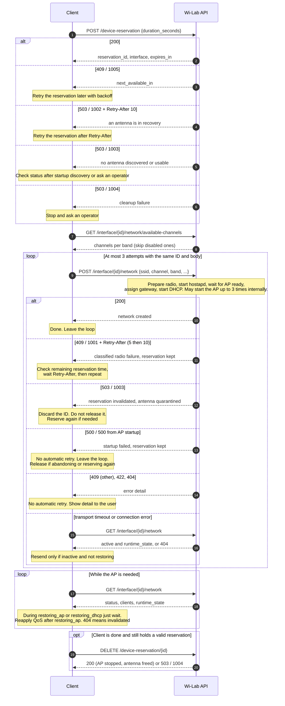

# AP creation procedure

This guide is for developers of Wi-Lab API clients. It describes how to reserve
an antenna and start an access point (AP) on it, which responses to expect, and
exactly when a request may be repeated. For the server internals behind each
step, see [Architecture](architecture.md).

All endpoints are under `/api/v1` and require `Authorization: Bearer <token>`.
Every error body has the same envelope:

```json
{"detail": {"code": 1001, "reason": "retry_later", "message": "optional text"}}
```

Use the HTTP status and `detail.code` for control flow. `detail.message` is for
display only and can change between versions.

## 1. Reservation

An AP always runs on a reserved antenna. The reservation decides **which**
antenna you get and **how long** you may use it.

```http
POST /api/v1/device-reservation
Content-Type: application/json

{"duration_seconds": 600}
```

| Response | Meaning | Client action |
|---|---|---|
| `200` | Antenna reserved. Body has `reservation_id`, `interface`, `display_name`, `expires_at`, `expires_in`. | Keep `reservation_id`: every following call uses it. |
| `409 / 1005` | All antennas are reserved. `detail.next_available_at` is the estimated availability in UTC; `detail.next_available_in` is the wait in seconds. Both are `null` when no release is scheduled. | Retry later with backoff, or wait for an unlimited reservation to be released. |
| `503 / 1002` + `Retry-After: 10` | No antenna can be assigned while an antenna is being recovered. | Retry **the reservation** after `Retry-After`. This is a polling interval, not a promise. |
| `503 / 1003` | No antenna has been discovered yet, or none is usable and recovery is not running. | If the pool is empty at startup, allow discovery time and check `/status` before reserving again. If antennas remain unavailable, ask an operator to investigate. |
| `503 / 1004` | Cleanup of an expired reservation failed. | Do not retry automatically. |
| `422` | `duration_seconds` is outside the server limits, or `0` while unlimited reservations are disabled. | Fix the request. |

Rules that matter for the AP:

- The AP lives only as long as the reservation. Creating or restarting an AP
  **never extends** `expires_at`. When the reservation expires, Wi-Lab stops
  the AP and frees the antenna.
- Reservation and network `expires_at` values use RFC 3339 UTC with a `Z`
  suffix (e.g. `2026-11-19T23:00:00Z`). They are `null` for unlimited
  reservations. `expires_in` is a countdown in seconds.
- The server picks the antenna (the first free one). You cannot choose it.
- Release the reservation when you are done:
  `DELETE /api/v1/device-reservation/{reservation_id}`. This also stops the AP;
  a separate network stop is not required. A `503 / 1004` on release means
  cleanup failed and the antenna is still held.
- `GET /api/v1/device-reservation/{reservation_id}` returns the remaining time.
  `404` means the ID is no longer valid (expired, released or invalidated).

## 2. Creating the AP

### 2.1 Choose a channel

Ask which channels the reserved antenna supports:

```http
GET /api/v1/interface/{reservation_id}/network/available-channels
```

The response lists 2.4 GHz and 5 GHz channels. Skip entries with
`"disabled": true`: they are blocked by regulatory restrictions or by the
server's DFS policy. By default (`allow_dfs_channels: false`, including when
omitted), Wi-Lab blocks channels flagged by the radio as requiring radar
detection. A creation request selecting one of those channels returns `422`
without starting the AP or substituting another channel.

To allow DFS channels where permitted, set `allow_dfs_channels: true` in
`config.yaml` and restart Wi-Lab. The radar check (CAC) on a DFS channel
usually takes about 60 seconds; Wi-Lab's current startup timeout for 5 GHz
channels 52–144 is 75 seconds, so longer checks can time out.

### 2.2 Build the request

```http
POST /api/v1/interface/{reservation_id}/network
Content-Type: application/json

{
  "radio": {
    "band": "2.4ghz",
    "channel": 6,
    "channel_width": 20,
    "wifi_generation": 4,
    "tx_power_level": 4
  },
  "wifi": {
    "ssid": "lab-test-01",
    "hidden": false,
    "security": {"encryption": "wpa2", "password": "testpass123"}
  },
  "internet": {"enabled": true},
  "captive_portal": {"enabled": false}
}
```

The body has the same sections as `GET .../network`. Only `radio` and `wifi`
are required; `internet` and `captive_portal` can be omitted.

| Field | Required | Rules |
|---|---|---|
| `radio.band` | yes | `2.4ghz` or `5ghz`. An AP uses one band. |
| `radio.channel` | yes | Must be valid for `band` and supported and enabled on the antenna. |
| `radio.channel_width` | no | `20`, `40` or `80` MHz. Default `20`, the previous behavior. See [2.2.1](#221-encryption-channel-width-and-wi-fi-generation). |
| `radio.wifi_generation` | no | `4` (802.11n), `5` (802.11ac, 5 GHz only) or `6` (802.11ax). Default `4`, the previous behavior. |
| `radio.tx_power_level` | yes | `1` (low) to `4` (maximum). |
| `wifi.ssid` | yes | Network name: 1–32 bytes in UTF-8 (non-ASCII characters count as more than one byte), no control characters such as line breaks or tabs. |
| `wifi.hidden` | no | Default `false`. |
| `wifi.security.encryption` | yes | `open`, `wpa1`, `wpa2`, `wpa3` or `wpa2-wpa3`; see [2.2.1](#221-encryption-channel-width-and-wi-fi-generation). `wpa` is no longer accepted (`422`): use `wpa2`. |
| `wifi.security.password` | unless `open` | 8–63 bytes in UTF-8 for any WPA mode, no control characters. |
| `internet.enabled` | no | Default from the server configuration. Enables NAT to the upstream network. |
| `captive_portal.enabled` | no | Default `false`. Puts clients behind a simulated captive portal; see [2.7](#27-captive-portal). |

Validate the body on the client side when possible: an invalid body returns
`422` without touching the antenna. The message names the field by its path,
for example `wifi.security.password: ...`.

#### 2.2.1 Encryption, channel width and Wi-Fi generation

Each antenna reports what it supports in `GET /api/v1/status`, under
`networks[].capabilities`. The list is read from the radio (`iw phy`) when
discovery adds the antenna; it is absent until then. A create that asks for
anything else returns `422` without touching the antenna.

```json
"capabilities": {
  "encryptions": ["open", "wpa1", "wpa2", "wpa3", "wpa2-wpa3"],
  "channel_widths": {"2.4ghz": [20, 40], "5ghz": [20, 40, 80]},
  "wifi_generations": {"2.4ghz": [4, 6], "5ghz": [4, 5, 6]}
}
```

| `wifi.security.encryption` | What hostapd runs | Notes |
|---|---|---|
| `open` | No encryption. | |
| `wpa2` | WPA2-Personal: PSK, CCMP. | What `wpa` used to create. |
| `wpa3` | WPA3-Personal: SAE, PMF required. | SAE accepts both hunting-and-pecking and H2E. |
| `wpa2-wpa3` | Mixed mode: PSK and SAE, CCMP. | WPA3 clients must use PMF, WPA2 clients do not. |
| `wpa1` | Legacy WPA: PSK, TKIP. | Only to test legacy clients. Insecure; TKIP forbids 802.11n, so the network is 802.11a/g at 20 MHz, at most 54 Mbit/s. Some recent clients warn or refuse to connect. Accepted only on antennas that list it (the driver must support TKIP). |

`wpa` is no longer accepted: it silently created WPA2, so a client that wanted
to test WPA1 was actually testing WPA2. It returns `422` with a message that
points to `wpa2` (same network as before) or `wpa1` (real legacy WPA).

**Channel width and Wi-Fi generation** are optional; the defaults (20 MHz,
802.11n) are the behaviour before 4.0.0, so existing clients do not change.

- `radio.wifi_generation: 5` (802.11ac) exists only on 5 GHz.
  `radio.channel_width: 80` exists only on 5 GHz and needs `wifi_generation` 5
  or 6. With `wpa1` only
  20 MHz and generation 4 are accepted.
- On 5 GHz a wide channel is a fixed block of 20 MHz channels: at 40 MHz
  36+40, 44+48, 52+56, ..., at 80 MHz 36–48, 52–64, 100–112, 116–128,
  132–144, 149–161, 165–177. `channel` is the primary channel inside the block.
  **Every channel of the block** must be enabled on the antenna: 165 at 80 MHz
  usually returns `422` because 169–177 are not allowed, and a block with DFS
  channels follows `allow_dfs_channels`.
- On 2.4 GHz `channel_width: 40` is accepted: the second channel is 4 above
  (or 4 below when above is not available). It occupies most of the band, and
  hostapd falls back to 20 MHz when it sees neighbouring networks (20/40
  coexistence), which is common with several APs on. `GET .../network` reports
  the width the radio actually uses in `radio.channel_width.reported`.
- `wifi_generation: 6` (802.11ax) is accepted where the antenna supports
  802.11ax in AP mode. On 5 GHz it is announced together with 802.11ac.

### 2.3 Send it with the right timeout

Creating an AP is synchronous: the response arrives only when the AP is
broadcasting and DHCP is running, or when startup has failed and been rolled
back. A start normally takes about 0.5 s. If the radio fails transiently,
Wi-Lab starts it again inside the same request (up to 3 starts): about 3 s
with one retry, 5–6 s with two, up to about 20 s in the worst case outside DFS
channels. A retry starts only if at least 4 s of the 20 s budget are left, so
every internal attempt is a real one. Configure the HTTP client with a long
read timeout so that a slow start is not mistaken for a failure:

| Channel | Suggested read timeout |
|---|---|
| 2.4 GHz and non-DFS 5 GHz | at least 60 s |
| DFS 5 GHz (52–144) | at least 120 s |

These are client recommendations, not server guarantees.

**Send only one create at a time per reservation.** Wi-Lab serializes work per
antenna, so parallel requests for the same reservation only queue up.

### 2.4 Handle the response

| Response | Meaning | Client action |
|---|---|---|
| `200` | The AP is up and DHCP is running. | Done. Stop retrying. |
| `409 / 1001` + `Retry-After` | A **classified radio failure** occurred and was rolled back. The reservation is still valid. | Wait `Retry-After` seconds, then repeat the **same** request with the **same** ID and body. |
| `409` without code `1001`, "already active" | An AP is already running on this reservation. | Do not retry. Read it with `GET .../network`, or stop it first with `DELETE .../network`. |
| `409` without code `1001`, "restoration in progress" | The watchdog is restarting this AP. | Do not create. Poll `GET .../network` until `runtime_state` is gone. |
| `422` | Invalid body (including `encryption: wpa`), channel unsupported/disabled on this antenna, or an encryption, channel width or Wi-Fi generation the antenna does not support. | Fix the request. Do not retry the same body. |
| `404` | The reservation is unknown, expired or invalidated. | Stop using the ID. Reserve again if needed. |
| `503 / 1003` | **Terminal failure.** The antenna was quarantined and the reservation **invalidated**. | Discard the ID. Do not retry creation and do not release it. Reserve again if needed. |
| `500 / 500` (generic startup error) | An unclassified startup error (e.g. `hostapd` exited with code 1, gateway or DHCP failure, or the NAT rules for `internet_enabled: true`, the isolation rules or the host guard rules could not be installed). The rollback succeeded and the reservation is **still valid**. | Do not retry automatically. Show `detail.message`. Release the ID if abandoning this attempt; release it before asking for a fresh reservation. |
| `503 / 1004` | A device cleanup failed. | Do not retry automatically. |
| `401` | Missing or invalid token. | Fix the token. |

The create waits for the adapter if another request on it is running, so it
never returns `503 / 1006`; the other reservation endpoints do (see
[2.6](#26-after-the-ap-is-running)).

After this generic startup `500`, `DELETE /api/v1/device-reservation/{id}`
releases the still-held antenna on `200`. The next reservation may get the same
antenna or a different one. Do not implement release → reserve → create as an
automatic recovery loop: that bypasses the retry budget. In contrast, after
`503 / 1003` the ID is already invalidated and must not be released.

### 2.5 When and how to retry

Only `409 / 1001` explicitly authorizes an automatic retry after a create error
response. Wi-Lab counts classified radio failures per reservation and allows
**three attempts** in a row:

| Attempt | Outcome if it fails with a classified radio failure |
|---|---|
| 1 | `409 / 1001`, `Retry-After: 5` |
| 2 | `409 / 1001`, `Retry-After: 10` |
| 3 | `503 / 1003`: reservation invalidated, antenna quarantined |

A success resets the counter. Further rules:

- **Respect `Retry-After`.** A request sent during the cooldown returns
  `409 / 1001` again with the remaining seconds (rounded up). It does not start
  the radio and does **not** use up an attempt, but it is wasted work.
- **Reuse the same ID and body.** A new reservation would start a new count on
  possibly another antenna and leaves this one held until it expires.
- **Check the remaining reservation time** before waiting. The cooldown does not
  extend the reservation; if it would expire first, release it and start over.
- **Do not count your own retries on top of the server's.** On the first
  attempt Wi-Lab already starts the AP up to 3 times internally after a
  transient radio failure, on either band, within about 20 seconds. A
  `409 / 1001` therefore means that those internal attempts also failed. The
  client sees only the final result.
- **Transport errors are ambiguous.** If the connection drops or the client
  times out, the server may have finished the AP or still be working on it. Do
  not resend the create blindly; first read the state:

  ```http
  GET /api/v1/interface/{reservation_id}/network
  ```

  The status call can wait for an in-progress create, so use a long timeout.
  During `restoring_ap` or `restoring_dhcp`, wait and read status again.
  Otherwise: `active: true` → the AP is up; `active: false` → you may send the
  create again; `404` → the ID is gone.

### 2.6 After the AP is running

- **No network: `409 / 1007`.** Internet, TX power and QoS profile requests
  on a valid reservation that has no running network return `409` with
  `detail.code: 1007` (`network_not_active`). Create a network first. A `404`
  on these endpoints always means the reservation itself is unknown, expired
  or invalidated.
- **Adapter busy: `503 / 1006`.** Every request on a reservation other than
  the create (`GET`/`DELETE .../network`, `available-channels`, Internet,
  TX power, QoS profile) waits at most **5 s** for another operation on the
  same adapter, such as a network start (up to 20 s, 75 s on a DFS channel).
  After that it returns `503` with `detail.code: 1006`,
  `reason: device_busy` and `Retry-After: 2`. Nothing was changed: repeat the
  same request after `Retry-After`. A create never returns `1006`: it waits
  for the adapter.

  ```json
  HTTP/1.1 503 Service Unavailable
  Retry-After: 2

  {"detail": {"code": 1006, "reason": "device_busy",
              "message": "Another operation on this adapter is still running; retry after Retry-After"}}
  ```

- `GET /api/v1/interface/{reservation_id}/network` returns the network in
  sections:

  ```json
  {
    "interface": "wlx7419f8176286", "active": true, "runtime_state": null,
    "reservation": {"expires_at": "2026-11-19T23:00:00Z", "expires_in": 3471},
    "radio": {
      "band": "5ghz", "channel": 36,
      "channel_width": {"requested": 80, "reported": 80},
      "wifi_generation": 5,
      "tx_power": {"requested_level": 4, "reported_level": 4, "reported_dbm": 20.0}
    },
    "wifi": {"ssid": "lab-test-01", "hidden": false,
             "security": {"encryption": "wpa2", "password": "testpass123"}},
    "ip": {"subnet": "192.168.120.0/24", "gateway": "192.168.120.1",
           "dhcp_range": {"start": "192.168.120.10", "end": "192.168.120.250"},
           "dns_server": "192.168.10.21"},
    "internet": {"enabled": true},
    "captive_portal": {"enabled": false, "url": null},
    "clients": [{"mac": "aa:bb:cc:dd:ee:01", "ip": "192.168.120.10"}]
  }
  ```

  | Section | Content |
  |---|---|
  | `reservation` | `expires_at` (UTC) and `expires_in` (seconds); always present. |
  | `radio` | Band, channel, channel width (`requested`, and `reported` by the radio: lower when hostapd fell back to 20 MHz on 2.4 GHz), Wi-Fi generation, TX power. |
  | `wifi` | SSID, hidden flag, `security` (encryption and password, returned so test devices can be connected). |
  | `ip` | Subnet, gateway, DHCP range and the DNS server announced to clients. |
  | `internet`, `captive_portal` | Whether NAT is enabled; whether the portal is on, and its URL. |
  | `clients` | Connected clients (`mac`, `ip`, and `captive_authorized` with a portal). The count is the list length. |

  While the network is not running, or while the watchdog restores it, only
  `interface`, `active`, `runtime_state` and `reservation` are set; the other
  sections are `null`.
- Wi-Lab's watchdog checks every running AP about every 5 seconds and restarts
  it with the same settings and reservation, up to 3 times per hour per
  antenna; a fourth failure within the hour quarantines the antenna. While this
  happens, `GET .../network` and `GET /api/v1/status` report `runtime_state`:

  | `runtime_state` | Meaning | Client action |
  |---|---|---|
  | `restoring_ap` | The AP is being restarted. Clients will need to reconnect. | Wait. Do not send a create. |
  | `restoring_dhcp` | Only DHCP is being restarted. The AP stays up. | Wait. |
  | `dhcp_failed` | DHCP could not be repaired alone (a restart failed, or dnsmasq died more than 3 times in an hour). Within 5 s the watchdog restarts the whole network (`restoring_ap`). | Wait. |
  | `restore_failed` | The AP restart failed for a non-radio reason. The AP is down (`active: false`); the watchdog retries after 15 s, 30 s, 60 s, 120 s, then every 5 minutes while the reservation is valid. | Wait for `runtime_state` to clear, or `DELETE .../network` to stop the retries (the reservation stays valid), or create a new network. |

- An AP restart clears traffic shaping and QoS profiles: reapply them after a
  `restoring_ap` phase.
- If the restart fails because of the radio, or the AP fails more than 3 times
  in an hour, the reservation is invalidated: `GET .../network` returns `404`.
  Reserve again. If it fails for another reason, the reservation stays valid
  and `runtime_state` is `restore_failed` until a retry succeeds.
- `GET /api/v1/status` reports `recovery_state` (`recovering` or `unavailable`)
  for quarantined antennas. They can show `reserved: false` but are **not**
  allocatable.
- To stop the AP but keep the antenna: `DELETE .../network`. To finish: release
  the reservation.

### 2.7 Captive portal

With `"captive_portal": {"enabled": true}`, each client that joins the AP is held behind a
simple portal until it signs in. Use it to check how a device detects a
captive network. Without the flag, nothing changes.

Until the client signs in:

- DNS queries are answered by the AP with the gateway address, so connectivity
  checks resolve and reach the portal even when `internet.enabled` is `false`.
- HTTP requests on port 80, to any host, are redirected (`302`) to the portal
  page, `http://<gateway>/`.
- Any other forwarded traffic, including HTTPS, is rejected.

The page, titled **WiLab Captive Portal**, shows the SSID, band and channel,
subnet, gateway, DHCP range, the client's IP and MAC address, whether the
network has Internet access, and when the network expires. Its **Sign in**
button releases only the client that pressed it, identified by its MAC and IP
address. Other clients stay on the portal. There is no API to sign a client
in.

After sign-in, the client uses the DNS server from the configuration and the
network's normal Internet setting: with `internet.enabled: false` it stays
offline. `GET .../network` reports `captive_portal.enabled`, `captive_portal.url`
and, for each client, `captive_authorized`.

Notes:

- Clients are detected through their HTTP connectivity checks. Wi-Lab does not
  advertise the portal via DHCP option 114 (RFC 8910) and does not intercept
  HTTPS.
- A client that obtains a new IP address, or changes its MAC address, must
  sign in again. Sign-ins are cleared when the AP stops, the reservation ends
  or the watchdog restarts the AP.
- The portal listens on port 80 and dnsmasq answers DNS on port 53, both on
  the AP gateway address only.

### 2.8 Service health: `degraded` and quarantined antennas

The client must check `GET /api/v1/status` to know whether every antenna is
usable. Poll it (for example every 10–30 s) and show the result to the user.

| `status` | Meaning |
|---|---|
| `standby` | No AP is active and no antenna is quarantined. |
| `ok` | APs are active and every health check passes. |
| `degraded` | At least one antenna is quarantined, a reserved AP is being repaired or has lost DHCP, a host command is stuck in the kernel, a background loop stalled, or a health check failed while APs are active. |

Find the cause in `networks[]` and `checks`:

```json
{
  "status": "degraded",
  "networks": [
    {"display_name": "antenna-1", "interface": "wlx7419f8176286", "reserved": false,
     "reservation_remaining_seconds": null, "recovery_state": "unavailable"},
    {"display_name": "antenna-2", "interface": "wlx7419f817651c", "reserved": false,
     "reservation_remaining_seconds": null}
  ]
}
```

| Field | Value | Meaning | Client action |
|---|---|---|---|
| `recovery_state` | `recovering` | Antenna quarantined; Wi-Lab is resetting and probing it. | Do not count it as available. It may return by itself. |
| `recovery_state` | `unavailable` | Antenna quarantined; no USB reset is running. Wi-Lab re-probes it periodically (after 30 s, backing off to every 15 min). | Do not count it as available. It may return by itself; report it to the operator if it persists. |
| `runtime_state` | `restoring_ap` / `restoring_dhcp` | The owner's AP is being repaired (see [2.6](#26-after-the-ap-is-running)). | Owner: wait. Others: nothing to do. |
| `runtime_state` | `dhcp_failed` | DHCP could not be repaired alone; the whole network is restarted within 5 s. | Owner: wait. |
| `runtime_state` | `restore_failed` | AP down after a failed restart; the watchdog retries with backoff. | Owner: wait, or `DELETE .../network` to stop the retries. |
| `checks.commands.stuck` | greater than 0 | A host command (`ip`, `iw`, `usbreset`, ...) did not exit even after SIGKILL: usually a hung Wi-Fi driver. Operations on the affected adapter fail instead of hanging. Set in standby too. | Report it to the operator: the adapter may need a reset or the host a reboot. |
| `checks.loops.stale` | not empty | A Wi-Lab background loop has not run for 3 minutes. Wi-Lab restarts itself as soon as no reservation is active. | Report it; release reservations you no longer need. |
| `checks.hostapd`, `checks.dnsmasq` | `running: false` | The hostapd or dnsmasq process of the networks in `missing` is not alive. | Report it; the watchdog normally repairs it within seconds. |
| `checks.iptables_nat` | `configured: false` | A network with Internet lost its NAT rule (`missing`). | Report it; Internet access does not work on that network until the watchdog repairs it. |
| `checks.upstream_interface` | `reachable: false` | The host uplink is down or has no IPv4 address. Counts only while a network has Internet enabled. | Report it; Internet access does not work. |

- `reserved: false` does **not** mean the antenna can be reserved: an entry
  with `recovery_state` is excluded from allocation.
- How a client learns that *its* antenna was quarantined: the create returns
  `503` with `detail.code: 1003`, `reason: device_unavailable` and
  `reservation_invalidated: true`. From then on the reservation ID returns
  `404`. There is no other notification: discard the ID and reserve again.
- New reservations skip quarantined antennas silently while another antenna is
  free. When none is allocatable because of quarantine, reserve returns `503`
  with `1002` (recovery in progress, retry after `Retry-After`) or `1003`
  (nothing is recovering).

## 3. Sequence diagram



## 4. Reference client logic

```python
def create_ap(api, reservation_id, body):
    for _ in range(3):
        try:
            r = api.post(f"/interface/{reservation_id}/network", json=body, timeout=120)
        except TransportError:
            state = api.get(f"/interface/{reservation_id}/network", timeout=120)
            if state.status_code == 404:
                raise ReservationLost()
            state.raise_for_status()
            network = state.json()
            if network.get("runtime_state") in ("restoring_ap", "restoring_dhcp"):
                network = wait_for_restoration(api, reservation_id)  # Bounded GET polling.
            if network["active"]:
                return network
            continue  # The previous create did not leave an AP: try again.

        code = r.json().get("detail", {}).get("code") if r.status_code >= 400 else None
        if r.status_code == 200:
            return api.get(f"/interface/{reservation_id}/network").json()
        if r.status_code == 409 and code == 1001:
            wait = int(r.headers["Retry-After"])
            if remaining_seconds(api, reservation_id) <= wait:
                raise ReservationTooShort()
            sleep(wait)
            continue
        if r.status_code == 503 and code == 1003:
            raise ReservationInvalidated()  # Do not release this ID.
        raise CreateFailed(r.status_code, r.json())  # No automatic retry.
    raise CreateFailed("retries exhausted")
```

## 5. What happens on the server

The client sees only the outcome; the following is useful to interpret it.
Details and diagrams are in [Architecture](architecture.md).

- **Classified radio failures** include a `hostapd` crash (segfault), a beacon
  rejected during interface setup, a timeout while preparing the radio, and an
  AP that does not reach the `ENABLED` state in time. They are radio failures in
  every create of the sequence, not only in the first one. After successful rollback the first two produce `409 / 1001`; the
  third invalidates the reservation (`503 / 1003`).
- **Unclassified failures** (for example `hostapd` exiting with code 1, a
  gateway, DHCP or captive portal startup error) are rolled back and return a
  generic `500`. They do not count as radio failures and do not invalidate the
  reservation. Radio failures while starting the AP are first retried
  internally (up to 3 starts); only if all fail does the request count as a
  radio failure (`409 / 1001`).
- **Unsafe cleanup**: if Wi-Lab cannot roll back a failed start, it invalidates
  the reservation and quarantines the antenna immediately (`503 / 1003`), even
  on the first attempt.
- **Quarantine and USB recovery**: a quarantined USB antenna may be reset
  automatically in the background. Until it is verified, it is reported as
  `recovering` and cannot be reserved; other antennas stay available. See
  [Architecture](architecture.md#8-quarantine-and-automatic-usb-recovery) and the
  [manual recovery procedure](architecture.md#82-manual-recovery).
