# Wi-Lab backend architecture

This document describes how the Wi-Lab backend works: components, startup,
threads and locks, the reservation lifecycle, the AP creation pipeline in
detail, the retry layers, the watchdog and automatic USB recovery. The client
side of AP creation is described in [AP creation procedure](ap-creation-procedure.md).

## 1. Overview

Wi-Lab is a single Python process (FastAPI served by Uvicorn) that turns Wi-Fi
adapters into isolated access points on demand. It does not implement Wi-Fi
itself: it drives standard Linux tools and keeps all orchestration state in
memory.

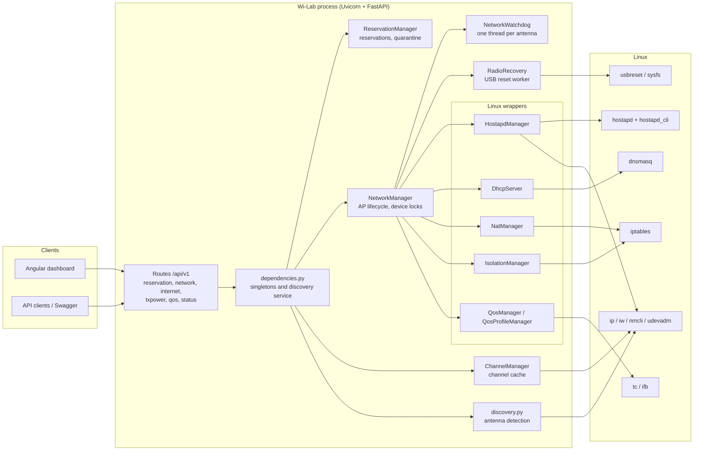

### Source layout

| Path | Responsibility |
|---|---|
| `main.py` | Process entry point: logging, safety checks, configuration, Uvicorn. |
| `wilab/config.py` | YAML configuration, antenna selection for each scan (names, `disable`, order). |
| `wilab/wifi/discovery.py` | Detects AP-capable Wi-Fi interfaces, udev readiness, USB port, default routes. |
| `wilab/api/__init__.py` | FastAPI app, lifespan (startup/shutdown), error handlers, frontend static files, OpenAPI. |
| `wilab/api/dependencies.py` | Lazily created singletons, `hold_reservation`, device scan and discovery service. |
| `wilab/api/routes/*.py` | HTTP endpoints. `network.py` contains the creation retry contract. |
| `wilab/reservation.py` | In-memory reservation store, expiry, quarantine state. |
| `wilab/wifi/manager.py` | `NetworkManager`: start/stop pipeline, device locks, expiry loop, TX power. |
| `wilab/wifi/hostapd.py` | hostapd configuration, process ownership, readiness check. |
| `wilab/wifi/watchdog.py` | Post-start supervision and bounded AP/DHCP restoration. |
| `wilab/wifi/recovery.py` | Automatic USB reset and verification of quarantined antennas. |
| `wilab/wifi/channels.py` | Regulatory domain and per-interface channel cache. |
| `wilab/network/dhcp.py` | dnsmasq configuration and process tracking. |
| `wilab/network/nat.py`, `isolation.py` | iptables NAT to the upstream interface and inter-AP isolation. |
| `wilab/network/qos.py`, `qos_profile.py` | Traffic shaping (HTB, netem, IFB) and QoS profiles. |
| `wilab/network/commands.py` | Bounded command execution, foreground process ownership. |

## 2. Startup and device discovery

Wi-Lab starts **without antennas**. A device discovery service, started with the
API, finds them and keeps looking for new ones for the whole life of the process.

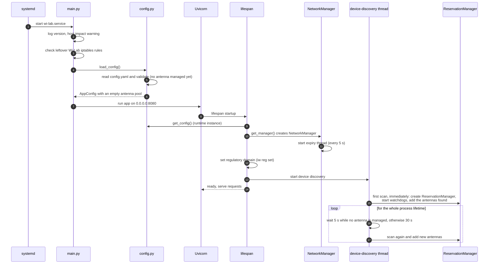

Notes:

- `main.py` loads the configuration only to fail fast on an invalid file. The
  runtime instance is loaded again in the lifespan through `get_config()`.
- Until the first scan adds an antenna, reservations return `503 / 1003`. The
  first scan runs as soon as the API starts, so this window is normally short.
- The first scan creates `ReservationManager` through
  `get_reservation_manager()`: it receives the device-lock provider and
  `release_device` as its cleanup callback, connects the expiry hook and starts
  the watchdog. Each antenna added later gets its own watchdog thread.

### Discovery service

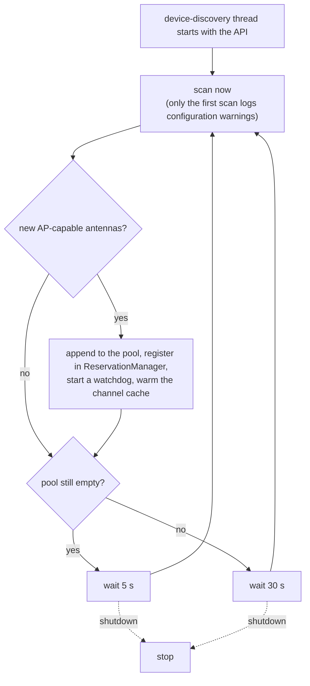

Each scan (`scan_devices()`):

1. Serializes with the scan lock.
2. Re-reads `networks` from `config.yaml`, so new display names and `disable`
   flags apply to antennas found later.
3. Discovers radios and keeps only those not already managed (by interface and
   by phy), not disabled and not upstream.
4. Appends them to the pool: existing antennas keep their position and subnet.

A scan never removes, disables or renames an antenna already in the pool; that
requires a service restart. A failed scan (for example an invalid
`config.yaml`) is logged once and retried at the next interval. Periodic scans
log at debug level, so they do not fill the journal.

The cost is small: on a host with two USB antennas a scan takes about 30 ms of
wall time and about 20 ms of CPU, running 7 short commands (`ip`, `iw`,
`udevadm`). A scan does not take device locks and does not touch the radios, so
it does not disturb running APs.

### Antenna detection

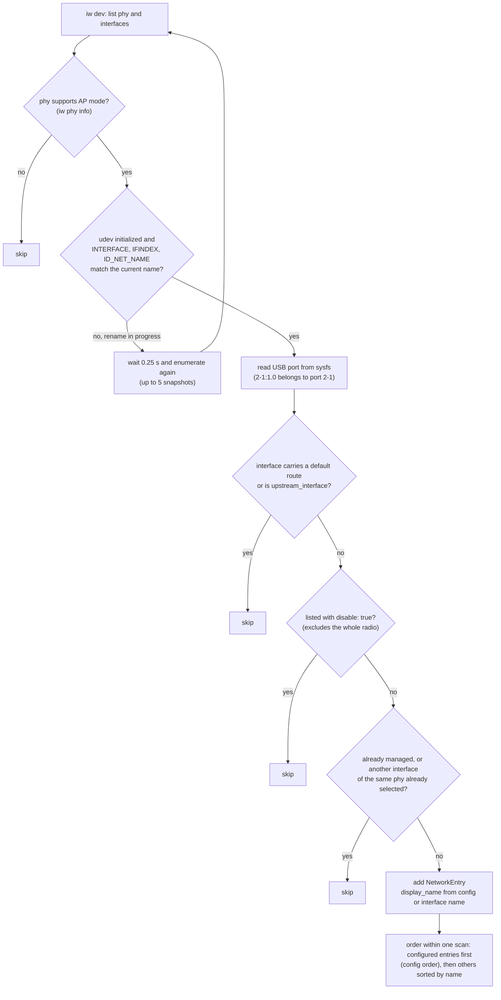

An interface still being renamed by udev is skipped, never saved under its
temporary kernel name; the next scan picks it up with its final name.

The AP allocator scans `/24` subnets from `dhcp_base_network` in antenna pool
order, skipping overlaps with host IPv4 routes and subnets assigned to other
antennas. It checks routes before a new AP start and reuses the antenna's previous
assignment if still safe. Newly discovered antennas are appended; active APs
keep their subnet. Antennas found by the same scan follow the configured order.

## 3. Concurrency model

Route handlers are synchronous (`def`), so Starlette runs them in its worker
thread pool, not in the event loop. Every Linux command is therefore blocking
but isolated to one worker thread.

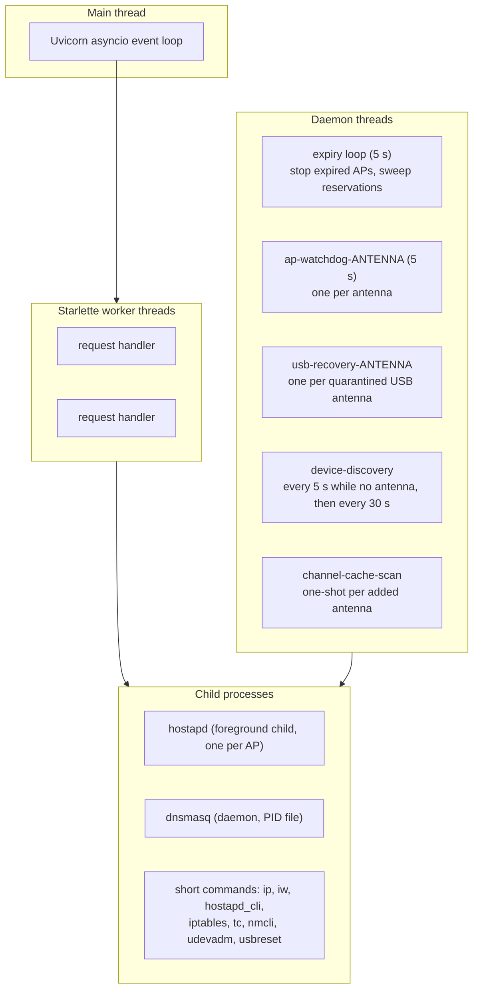

### Locks

| Lock | Owner | Protects |
|---|---|---|
| Device lock (`RLock` per antenna) | `NetworkManager.device_lock()` | Start, stop, status, cleanup, watchdog restore and USB recovery of one antenna. Different antennas never wait for each other. |
| Store lock | `ReservationManager._lock` | Reservation maps and quarantine state. Held only briefly. |
| Firewall lock | `NetworkManager._firewall_lock` | iptables changes (NAT, isolation) shared by all antennas. |
| Scan lock | `dependencies._scan_lock` | One device scan at a time. |
| Singleton lock | `dependencies._singleton_lock` | Lazy creation of the managers. |

Rules:

- Lock order is **device lock, then store lock**. Code never waits for a
  device lock while holding the store lock.
- `hold_reservation()` takes the device lock and re-checks that the
  reservation is still current, so a concurrent release cannot free the
  antenna in the middle of an operation.
- Background loops (expiry, watchdog) use non-blocking acquisition: a busy
  antenna is skipped until the next tick instead of blocking the loop.
- `GET /api/v1/status` reads snapshots and never waits for a device lock or
  runs cleanup, so it stays responsive while an antenna is slow. It still runs
  host health commands and is not a latency guarantee.

## 4. Reservation lifecycle

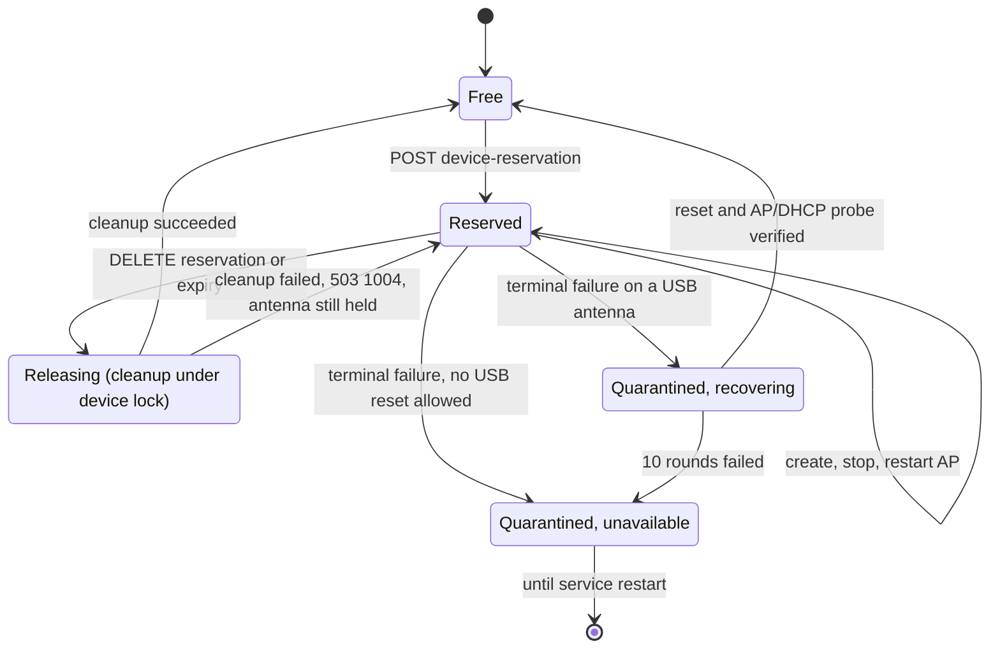

- A reservation holds `reservation_id` (8 hex chars), `device_id`,
  `expires_at` (`None` when unlimited), the radio failure counter
  `radio_failures`, the cooldown deadline `retry_at` and a counter of releases
  in progress.
- **Allocation** picks the first antenna in pool order that is neither reserved
  nor quarantined. When none is free, expired reservations are purged first;
  then the response is `409 / 1005` (busy), `503 / 1002` (an antenna is
  recovering) or `503 / 1003` (all quarantined, or no antenna).
- **Expiry** is enforced in two places: lazily when the ID is used (the request
  gets `404` after cleanup) and by the expiry loop every 5 seconds.
- **Release** cleans up first and frees the antenna only if cleanup succeeded.
- **Quarantine** removes the reservation and marks the antenna as blocked in a
  single store operation, so the ID becomes `404` and the antenna cannot be
  allocated.
- Everything is in memory. A restart loses reservations and quarantine; it does
  not repair a failing radio.

## 5. AP creation in detail

### 5.1 Request pipeline

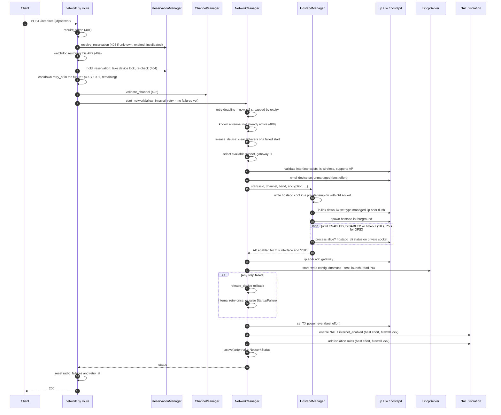

### 5.2 hostapd startup and readiness

hostapd is started as a **foreground child process** owned by Wi-Lab, not as a
daemon. Wi-Lab therefore knows immediately when it exits, and how:

- exit by `SIGSEGV` → `HostapdSegfault` (a classified radio failure);
- any other exit code → `HostapdError` (unclassified);
- timeout of `ip link down`, `iw set type managed` or `ip addr flush` →
  `HostapdRadioFailure` ("radio preparation timed out");
- `hostapd_cli status` timing out → `HostapdRadioFailure`;
- state `DISABLED`, or not `ENABLED` with the right interface and SSID within
  the timeout → `HostapdRadioFailure` ("AP not ready").

The AP is ready only when `hostapd_cli` on the instance's private control
socket reports `state=ENABLED`, `bss[0]` equal to the interface and `ssid[0]`
equal to the requested SSID. The timeout is 10 seconds, or 75 seconds for
5 GHz DFS channels 52–144 because of the radar check. The configuration enables
`ieee80211d` on all bands and `ieee80211h` on 5 GHz.

Only after the AP is confirmed does Wi-Lab assign the gateway and start DHCP:
the order is **AP → gateway → DHCP**.

On readiness failure, Wi-Lab logs one `hostapd startup failure` entry with the
interface, elapsed time and budget, socket presence, last known state, last
probe outcome, and any observed exit code. The child output is continuously
drained; only the last twelve allowlisted event labels are kept in memory and
included in the failure entry. This diagnostic never includes raw child
output, SSIDs or credentials and creates no additional file. It does not change
readiness deadlines or retry classification. An exit code of `1` alone does
not identify the cause.

### 5.3 Rollback and teardown

On any failure the start is rolled back with `release_device()`, which runs the
normal teardown. The same teardown is used by stop, release, expiry, watchdog
and recovery:

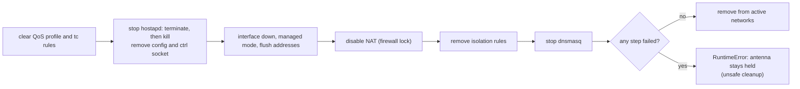

Every step runs even if an earlier one fails, and errors are reported together.
The radio is always left `managed` and `DOWN` between networks.

## 6. Retry layers

Wi-Lab recovers from radio problems at three levels, from fastest to most
drastic.

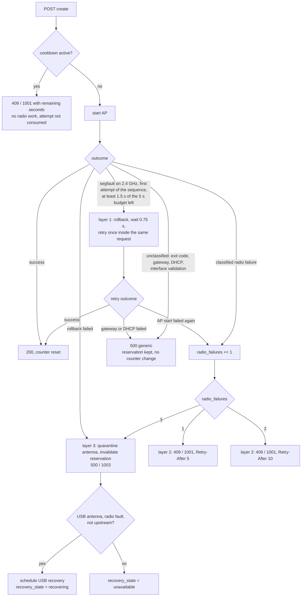

| Layer | Where | Trigger | Limit |
|---|---|---|---|
| 1. Internal retry | Inside one request (`NetworkManager`) | hostapd segfault on 2.4 GHz, first request of the sequence | Once, within a 5 s budget capped by expiry. If the AP fails to start again, it counts as a radio failure. |
| 2. Client retry with cooldown | Across requests (route + `Reservation`) | Classified radio failure | 3 attempts per sequence, cooldowns 5 s and 10 s. Success resets the counter. |
| 3. Quarantine and USB recovery | Background worker | 3rd classified failure, unsafe rollback, or a failed watchdog restart | 10 rounds at least 60 s apart, USB antennas only. |

An unclassified startup failure with successful rollback returns `500 / 500`
without `Retry-After`. It does not consume the radio budget, but the reservation
still holds the antenna. `release_device()` in the rollback cleans up the
network; it does not delete the reservation. The client can release the ID
explicitly when it no longer needs it. Success after releasing and reserving
the same antenna again shows reuse worked, not that retrying with the original
ID would have worked.

Do not classify an isolated hostapd exit code `1` as a radio failure based on
the exit code alone: that would also make persistent non-radio failures eligible
for quarantine after three attempts. A more specific transient failure signal
would be needed before routing these exits through the cooldown path.

## 7. After start: watchdog

Each antenna has a watchdog thread that wakes up every 5 seconds.

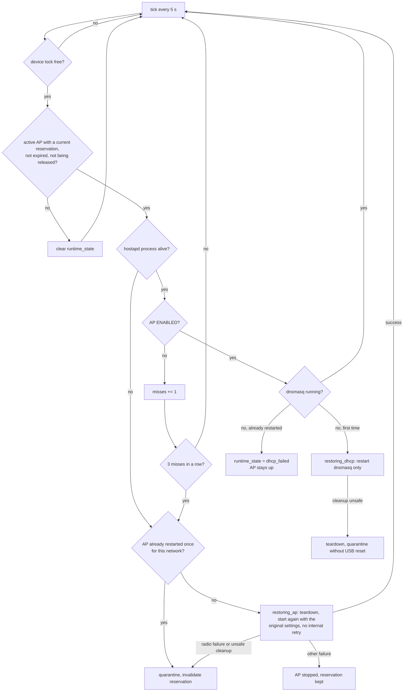

- No connected stations is not a failure.
- The restart keeps the reservation and its expiry. Clients must reconnect; QoS
  is cleared by the teardown and must be reapplied.
- Release or expiry cancels a pending restart. If a restart already ran, its
  result is cleaned up under the device lock before the antenna can be reused.
- `POST create` returns `409` while `restoring_ap` or `restoring_dhcp` is set.

## 8. Quarantine and automatic USB recovery

A quarantined antenna is excluded from allocation. If it is a USB adapter
(detected from sysfs at discovery), the failure was a radio fault and it is not
the upstream interface, Wi-Lab starts a recovery worker for it.

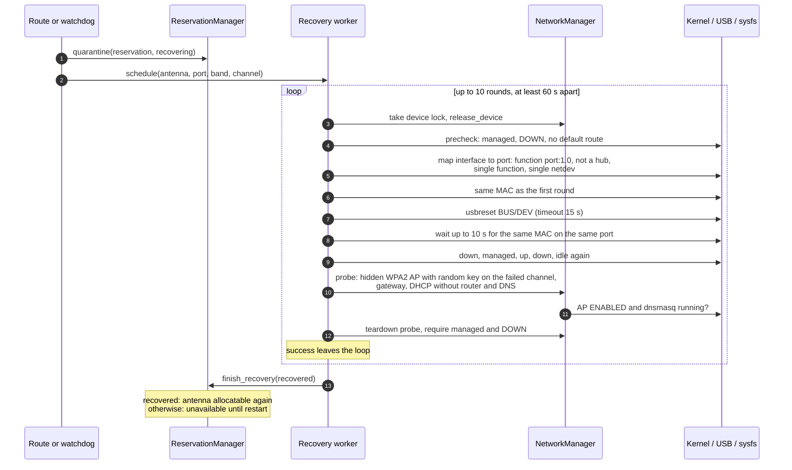

- A failed precheck skips the reset for that round.
- The probe is a server-side check only: it does not prove that a real station
  can associate and get a lease.
- Other antennas stay fully available during recovery.
- For hardware that does not recover, use the
  [manual recovery procedure](manual_recovery.md).

## 9. Expiry and shutdown

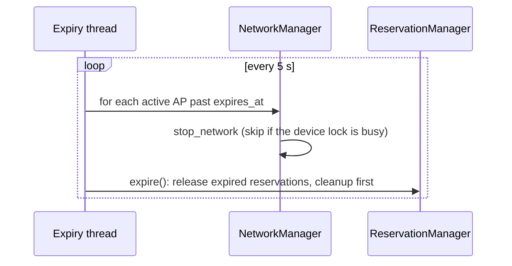

On shutdown (`SIGTERM` from systemd) the lifespan stops device discovery, waits
briefly for it and calls `shutdown_all()`: it stops the recovery
worker and the watchdogs, then runs `release_device()` for every antenna so that
no hostapd, dnsmasq, iptables or tc state is left behind.

## 10. Host state and files

| State | Location | Lifetime |
|---|---|---|
| Reservations, quarantine, active networks, watchdog states | Process memory | Lost on restart. |
| hostapd configuration and control socket | `/tmp/wilab-hostapd/ap-*/` | Removed at teardown. Contains the WPA passphrase. |
| dnsmasq configuration, leases, PID | `/tmp/wilab-dnsmasq/` | Removed at teardown. |
| NAT and isolation rules | iptables `nat` and `FORWARD` | Removed at teardown. Leftovers are reported at startup. |
| Traffic shaping | tc qdiscs, IFB devices | Removed at teardown. |

The upstream interface is resolved from the default route on first use and
cached; set `upstream_interface` to force it.

## 11. Observability

- Every API `5xx` logs `API failure operation=<route> http_status=<code>
  detail_code=<code>` without IDs, tokens or bodies:
  `journalctl -u wi-lab.service -g 'API failure operation='`.
- Discovery logs every added antenna with its USB port (or `non-USB`) and
  subnet. The first scan also logs skipped interfaces with the reason.
- `GET /api/v1/status` exposes `runtime_state` (watchdog) and `recovery_state`
  (quarantine) per antenna. `GET /api/v1/debug` gives a detailed, slower
  snapshot for troubleshooting.

## 12. Known limitations

- **A USB reset stuck in the kernel blocks its antenna.** If `usbreset` enters
  an uninterruptible kernel state, its timeout cannot terminate it. The recovery
  thread then waits forever while holding that antenna's device lock: the
  antenna stays `recovering`, and service shutdown also waits on that lock until
  systemd kills the process. Other antennas keep working. Recovering the adapter
  then requires unplugging it or restarting the VM or host.
- Antennas are added at runtime but never removed: an antenna unplugged while in
  the pool stays listed until the service restarts.
- All coordination state is in memory and assumes a single Wi-Lab process per
  host.
