# Wi-Lab backend architecture

This document describes how the Wi-Lab backend works: components, startup,
threads and locks, the reservation lifecycle, the AP creation pipeline in
detail, the retry layers, the watchdog, automatic USB recovery and the manual
recovery procedure. The client
side of AP creation is described in [AP creation procedure](ap-creation-procedure.md).

## 1. Overview

Wi-Lab is a single Python process (FastAPI served by Uvicorn) that turns Wi-Fi
adapters into isolated access points on demand. It does not implement Wi-Fi
itself: it drives standard Linux tools and keeps all orchestration state in
memory.

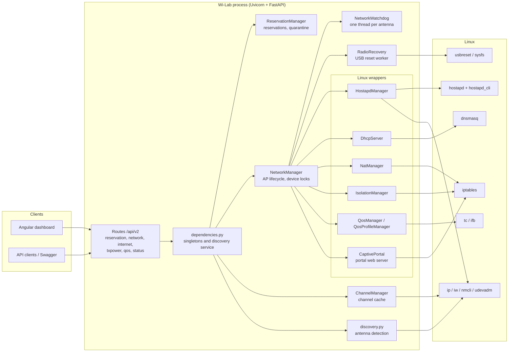

### Source layout

| Path | Responsibility |
|---|---|
| `main.py` | Process entry point: logging, safety checks, configuration, Uvicorn. |
| `wilab/config.py` | YAML configuration, antenna selection for each scan (names, `disable`, order). |
| `wilab/wifi/discovery.py` | Detects AP-capable Wi-Fi interfaces, udev readiness, USB port, default routes. |
| `wilab/api/__init__.py` | FastAPI app, lifespan (startup/shutdown), error handlers, frontend static files, OpenAPI. |
| `wilab/api/dependencies.py` | Lazily created singletons, `hold_reservation`, device scan and discovery service. |
| `wilab/api/routes/*.py` | HTTP endpoints. `network.py` contains the creation retry contract. |
| `wilab/reservation.py` | In-memory reservation store, expiry, quarantine state. |
| `wilab/wifi/manager.py` | `NetworkManager`: start/stop pipeline, device locks, expiry loop, TX power. |
| `wilab/health.py` | Health checks that run host commands (hostapd and dnsmasq alive, NAT rules, upstream link), refreshed every 10 s by the `health-checks` thread; `/status` reads the latest result and runs no command (recomputed by the reader only if older than 20 s). |
| `wilab/wifi/hostapd.py` | hostapd configuration, process ownership, readiness check. |
| `wilab/wifi/watchdog.py` | Post-start supervision and bounded AP/DHCP restoration. |
| `wilab/wifi/recovery.py` | Automatic USB reset and verification of quarantined antennas. |
| `wilab/wifi/channels.py` | Regulatory domain and per-interface channel cache, one instance shared by the API and `NetworkManager`. A channel refused from the cache is checked again against a fresh `iw` reading; the cache of an antenna is dropped after a USB recovery or re-probe and after a failed start (Fable BUG-4). |
| `wilab/network/dhcp.py` | dnsmasq configuration and process tracking. |
| `wilab/network/nat.py`, `isolation.py` | iptables NAT to the upstream interface and inter-AP isolation. |
| `wilab/network/captive.py` | Optional captive portal: per-AP redirection chains and portal web server. |
| `wilab/network/qos.py`, `qos_profile.py` | Traffic shaping (HTB, netem, IFB) and QoS profiles. |
| `wilab/network/commands.py` | Bounded command execution, foreground process ownership. |

## 2. Startup and device discovery

Wi-Lab starts **without antennas**. A device discovery service, started with the
API, finds them and keeps looking for new ones for the whole life of the process.

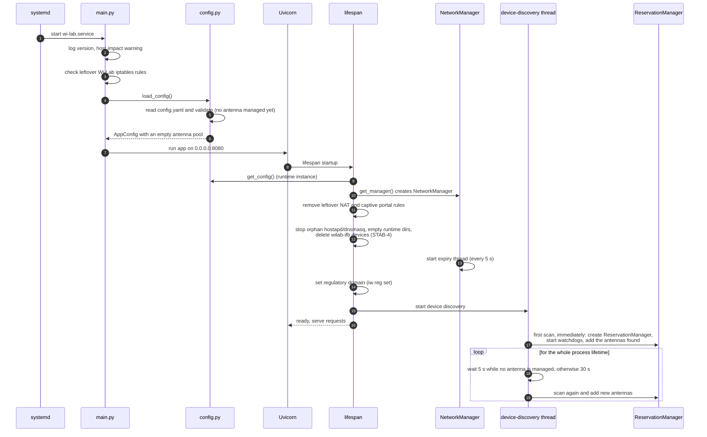

Notes:

- `main.py` loads the configuration only to fail fast on an invalid file. The
  runtime instance is loaded again in the lifespan through `get_config()`.
- Until the first scan adds an antenna, reservations return `503 / 1003`. The
  first scan runs as soon as the API starts, so this window is normally short.
- The first scan creates `ReservationManager` through
  `get_reservation_manager()`: it receives the device-lock provider and
  `release_device` as its cleanup callback, connects the expiry hook and starts
  the watchdog. Each antenna added later gets its own watchdog thread.

### Discovery service

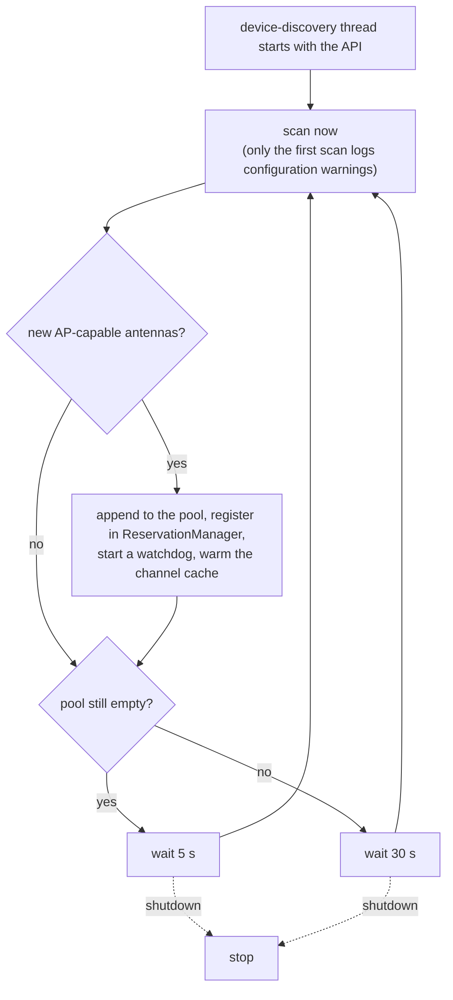

Each scan (`scan_devices()`):

1. Serializes with the scan lock.
2. Re-reads `antennas` from `config.yaml`, so new display names, `disable` and `show_dfs`
   flags apply to antennas found later.
3. Discovers radios and keeps only those not already managed (by interface and
   by phy), not disabled and not upstream.
4. Appends them to the pool: existing antennas keep their position and subnet.

A scan never removes, disables or renames an antenna already in the pool; that
requires a service restart. A failed scan (for example an invalid
`config.yaml`) is logged once and retried at the next interval. Periodic scans
log at debug level, so they do not fill the journal.

The cost is small: on a host with two USB antennas a scan takes about 30 ms of
wall time and about 20 ms of CPU, running 7 short commands (`ip`, `iw`,
`udevadm`). A scan does not take device locks and does not touch the radios of
existing antennas, so it does not disturb running APs.

**Cleanup of an unclean shutdown (Fable STAB-4).** At startup, before discovery,
`cleanup_runtime()` (`wilab/runtime_cleanup.py`) stops hostapd and dnsmasq
processes whose arguments point into `/tmp/wilab-hostapd` or
`/tmp/wilab-dnsmasq` (they survive only when the service is not run by
systemd), empties those directories, so a stale dnsmasq PID file can no longer
fail every start with "Existing dnsmasq PID file", and deletes `wilab-ifbN`
devices. QoS names its upload devices `wilab-ifbN` for this reason; plain
`ifbN` devices may belong to other software and are left alone. When discovery
adds an antenna, `reset_interface()` takes its device lock once and brings it
down, to managed mode, without IPv4 addresses and without `root`/`ingress`
qdiscs, so a netem rule or a gateway address of the previous run cannot degrade
the next network or shift its subnet.

### Antenna detection

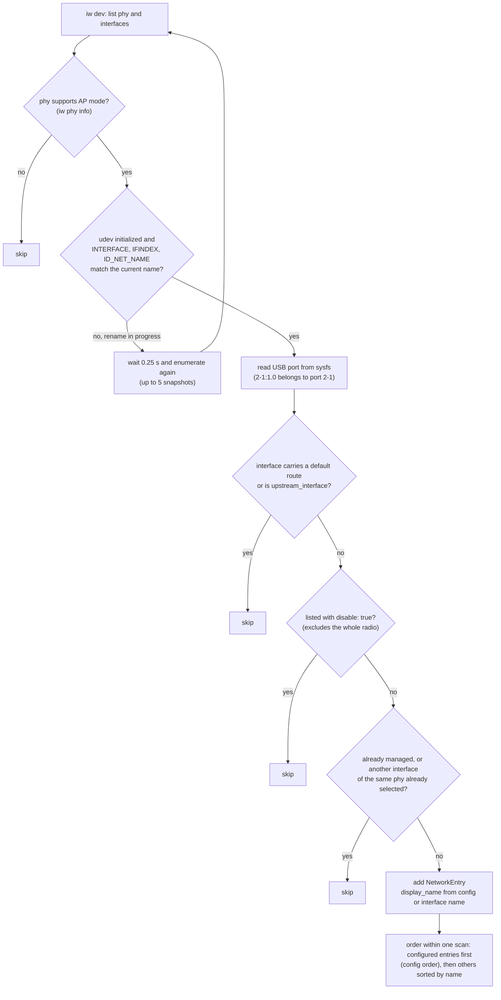

An interface still being renamed by udev is skipped, never saved under its
temporary kernel name; the next scan picks it up with its final name.

**Wi-Fi interfaces used by the host.** `disable: true` excludes a radio on every
scan, whatever its state. Without it, a Wi-Fi interface the host uses as a
client is protected only by its default route, which exists only while it is
connected: if it is disconnected during a scan, Wi-Lab can add it to the pool,
exclude it from NetworkManager and use it as an AP. List such interfaces with
`disable: true`. Recommended: do not connect the Wi-Lab host via Wi-Fi.

The AP allocator scans `/24` subnets from `dhcp_base_network` in antenna pool
order, skipping overlaps with host IPv4 routes and subnets assigned to other
antennas. It checks routes before a new AP start and reuses the antenna's previous
assignment if still safe. Newly discovered antennas are appended; active APs
keep their subnet. Antennas found by the same scan follow the configured order.

## 3. Concurrency model

Route handlers are synchronous (`def`), so Starlette runs them in its worker
thread pool, not in the event loop. Every Linux command is therefore blocking
but isolated to one worker thread.

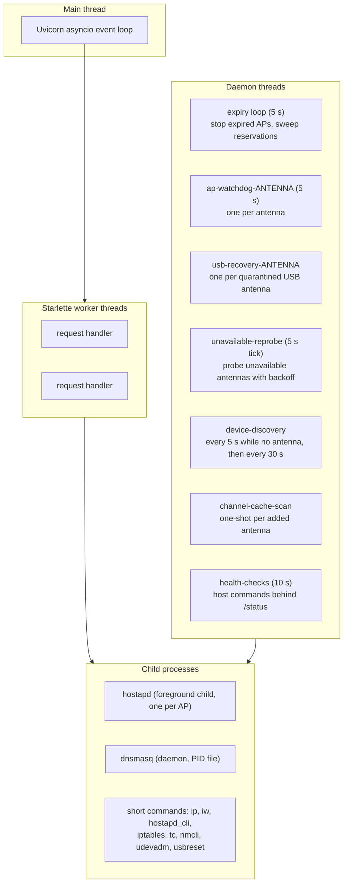

### Locks

| Lock | Owner | Protects |
|---|---|---|
| Device lock (`RLock` per antenna) | `NetworkManager.device_lock()` | Start, stop, status, cleanup, watchdog restore and USB recovery of one antenna. Different antennas never wait for each other. |
| Store lock | `ReservationManager._lock` | Reservation maps and quarantine state. Held only briefly. |
| Firewall lock | `NetworkManager._firewall_lock` | iptables changes (NAT, isolation, captive portal, host guard) shared by all antennas, and the firewall reads of the health checks (`firewall_status()`), so a read never collides with a change. Every `iptables` call goes through `execute_iptables()`, which adds `-w 5`: with the legacy backend iptables then waits up to 5 s for the global xtables lock (also taken by Docker, ufw or fail2ban) instead of failing at once (NET-1). The nf_tables backend accepts and ignores `-w`. |
| Scan lock | `dependencies._scan_lock` | One device scan at a time. |
| Singleton lock | `dependencies._singleton_lock` | Lazy creation of the managers. |

Rules:

- Lock order is **device lock, then store lock**. Code never waits for a
  device lock while holding the store lock.
- `hold_reservation()` takes the device lock and re-checks that the
  reservation is still current, so a concurrent release cannot free the
  antenna in the middle of an operation. API requests wait at most
  `DEVICE_BUSY_TIMEOUT` (5 s) and then return `503 / 1006 device_busy` with
  `Retry-After: 2` (Fable RACE-1), so polling clients cannot park the 40
  request threads behind a slow start. The create waits without limit
  (`wait=True`): one create at a time per reservation is the client contract,
  and the start that holds the lock is itself bounded.
- Background loops (expiry, watchdog) use non-blocking acquisition: a busy
  antenna is skipped until the next tick instead of blocking the loop.
- `GET /api/v2/status` reads snapshots and never waits for a device lock or
  runs cleanup, so it stays responsive while an antenna is slow. It still runs
  host health commands and is not a latency guarantee.

## 4. Reservation lifecycle

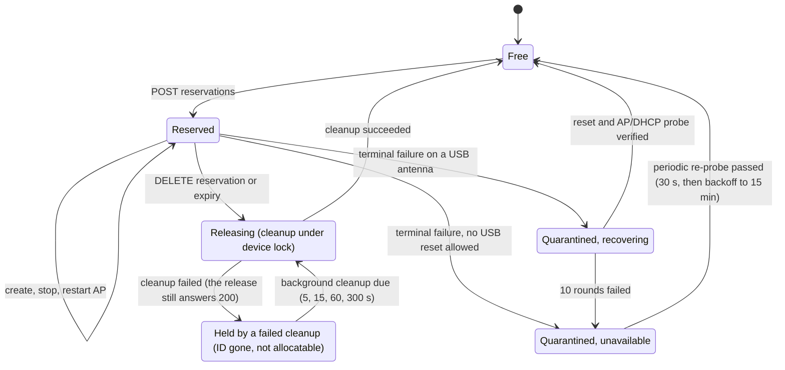

- A reservation holds `reservation_id` (8 hex chars), `device_id`,
  `expires_at` (`None` when unlimited) and a counter of releases in progress.
  Radio failures are counted per create request, not per reservation.
- **Allocation** picks the first antenna in pool order that is neither reserved
  nor quarantined. When none is free, expired reservations are purged first;
  then the response is `409 / 1005` (busy), `503 / 1002` (an antenna is
  recovering) or `503 / 1003` (all quarantined, or no antenna).
- **Expiry** is enforced in two places: lazily when the ID is used (the request
  gets `404` after cleanup) and by the expiry loop every 5 seconds.
- **Release** cleans up first and frees the antenna only if cleanup succeeded.
- **Failed cleanup backoff (WD-6):** when the cleanup of an antenna fails, the
  expiry loop and the background reservation sweep retry it after 5, 15, 60
  and then every 300 s (`CLEANUP_BACKOFF`), instead of every 5 s. A client's
  explicit release or a reservation request that purges an expired one always
  tries for real. The full traceback is logged once per failure series, then
  short warnings; a success logs that the cleanup recovered.
- **Quarantine** removes the reservation and marks the antenna as blocked in a
  single store operation, so the ID becomes `404` and the antenna cannot be
  allocated.
- An **unavailable** antenna is re-probed periodically (see
  [section 8.1](#81-re-probe-of-unavailable-antennas)), so it returns to the pool
  without a service restart once it works again.
- Everything is in memory. A restart loses reservations and quarantine; it does
  not repair a failing radio.

## 5. AP creation in detail

### 5.1 Request pipeline

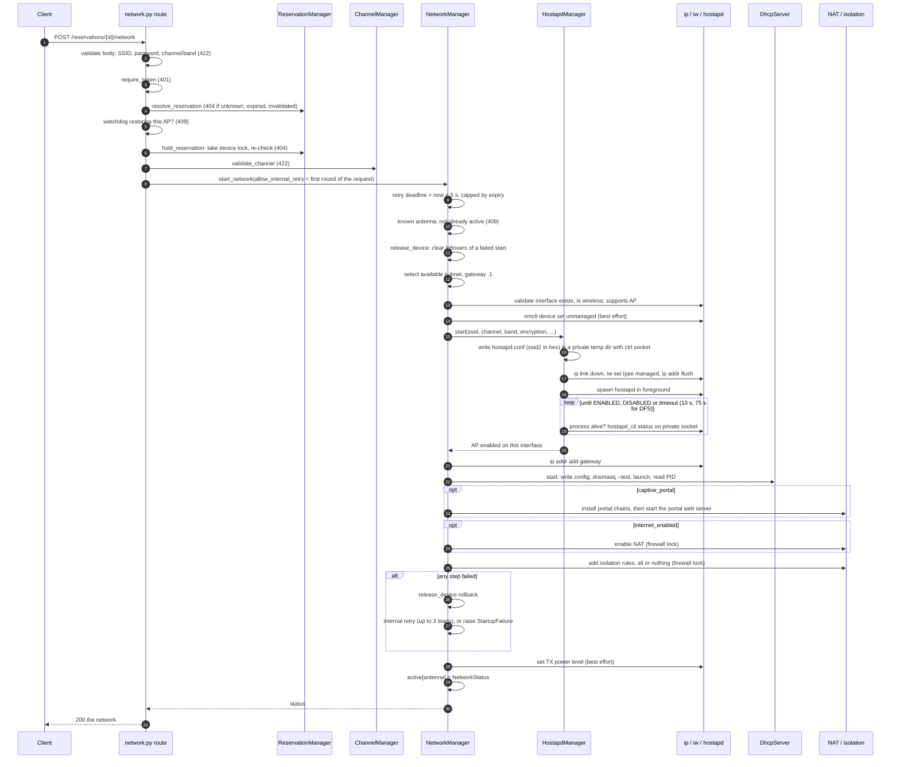

### 5.2 hostapd startup and readiness

hostapd is started as a **foreground child process** owned by Wi-Lab, not as a
daemon. Wi-Lab therefore knows immediately when it exits, and how:

- exit by `SIGSEGV` → `HostapdSegfault` (a classified radio failure);
- exit after the output reported both a failed beacon setup and a failed
  interface initialization → `HostapdInitFailure`, a subclass of
  `HostapdRadioFailure` (a classified radio failure on every attempt and request,
  Fable HAP-3; retried internally, see [section 6](#6-retry-layers));
- any other exit code → `HostapdError` (unclassified);
- timeout of `ip link down`, `iw set type managed` or `ip addr flush` →
  `HostapdRadioFailure` ("radio preparation timed out");
- `hostapd_cli status` with no reply until the readiness timeout → `HostapdRadioFailure`.
  Each probe waits at most 1 s and the process is checked between probes:
  `hostapd_cli` keeps waiting for a reply from a hostapd that has already exited,
  which previously delayed such failures until the full timeout (about 10.3 s);
- state `DISABLED`, or not `ENABLED` on the right interface within
  the timeout → `HostapdRadioFailure` ("AP not ready"). After `DISABLED`
  Wi-Lab waits up to 0.5 s (`DISABLED_SETTLE`) for hostapd to exit, then
  classifies from the exit and the output: with a failed beacon setup it is
  `HostapdInitFailure`, whether the probe saw `DISABLED` or the exit first
  (Fable HAP-2).

The AP is ready only when `hostapd_cli` on the instance's private control
socket reports `state=ENABLED` and `bss[0]` equal to the interface. The SSID is
not compared: hostapd prints `ssid[0]` with escapes (`\xNN` for non-ASCII bytes,
`\"`, `\\`), so an SSID such as `Caffè` would never match, and the control
directory is private to the instance, so state and interface already identify
the AP. The watchdog probe (`is_enabled`) uses the same rule. The timeout is 10 seconds, or 75 seconds for
5 GHz DFS channels 52–144 because of the radar check. The configuration enables
`ieee80211d` on all bands and `ieee80211h` on 5 GHz.

The request body (sections `radio`, `wifi`, `internet`, `captive_portal`, model
`NetworkCreateBody`) is converted to the flat `NetworkCreateRequest` the
manager works with, and `GET .../network` builds the sectioned
`NetworkResponse` from the internal `NetworkStatus` (Fable API-8, first step of ARCH-3). The body
is validated before any antenna is touched: `ssid` must be
1–32 bytes in UTF-8, `password` 8–63 bytes for WPA modes, neither may contain
control characters (including CR/LF), and `channel` must be a standard channel
for `band`. Cross-field rules run in a Pydantic `model_validator`, because a
field validator only sees fields declared before it. As a second line of
defence, the hostapd configuration writes the SSID as `ssid2=<hex>` and the
generator refuses line breaks in SSID, passphrase and country code, so no value
can add lines to `hostapd.conf`.

Only after the AP is confirmed does Wi-Lab assign the gateway and start DHCP:
the order is **AP → gateway → DHCP**.

On readiness failure, Wi-Lab logs one `hostapd startup failure` entry with the
interface, elapsed time and budget, socket presence, last known state, last
probe outcome, and any observed exit code. The child output is continuously
drained; only the last twelve allowlisted event labels are kept in memory and
included in the failure entry. This diagnostic never includes raw child
output, SSIDs or credentials and creates no additional file. It does not change
readiness deadlines or retry classification. An exit code of `1` alone does
not identify the cause.

### 5.3 Rollback and teardown

On any failure the start is rolled back with `release_device()`, which runs the
normal teardown. The same teardown is used by stop, release, expiry, watchdog
and recovery:

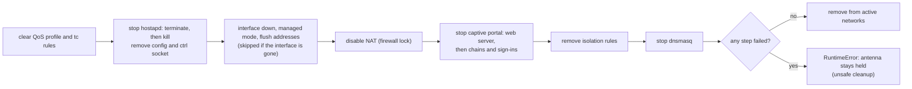

Every step runs even if an earlier one fails, and errors are reported together.
The radio is always left `managed` and `DOWN` between networks.

If the interface no longer exists (`/sys/class/net/<if>` missing: USB
disconnect, firmware crash with a driver-initiated USB reset, driver unloaded),
the interface reset is skipped with a warning instead of failing on
`Cannot find device`. A re-enumerated netdev already starts `DOWN`, managed and
without addresses, and the firewall, QoS and DHCP steps do not need the
interface to exist. Before this, a vanished adapter made every teardown fail,
the startup rollback raised `cleanup_failed` and the antenna stayed quarantined
until a restart (incident of 2026-11-23 12:23).

### 5.4 Captive portal

`captive_portal.enabled` is optional in the create request; omitted or `false`, none of
the following happens. When `true`, after DHCP starts Wi-Lab builds a
`CaptivePortal` for the AP. A failure here is an unclassified startup failure:
the start is rolled back and the client gets `500 / 1013` with `stage: captive_portal`.

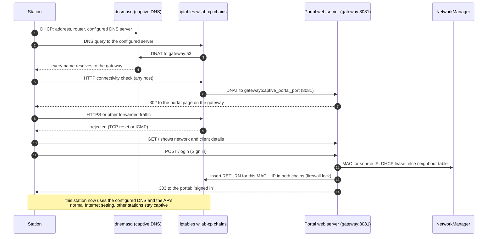

| Element | Captive AP only |
|---|---|
| dnsmasq | Listens on gateway:53 (`except-interface=lo`), answers `address=/#/<gateway>`. Clients still receive the configured DNS server. |
| `nat` chain `wilab-cp-<interface>` | Jumped to first from `PREROUTING` for traffic entering the AP. Per-client `RETURN` rules, then DNAT of UDP/TCP 53 to gateway:53 and TCP 80 to gateway:`captive_portal_port` (8081). |
| `filter` chain `wilab-cp-<interface>` | Jumped to first from `FORWARD`. Per-client `RETURN` rules, then reject everything else. |
| Portal web server | Threaded HTTP server bound to gateway:`captive_portal_port` only (default 8081, not 80, so the Wi-Lab API itself can listen on port 80 of every address; one port serves every AP because each binds its own gateway). A port already in use fails the start with a message naming the setting; a malformed `Content-Length` answers `400`. `GET /` renders the page, `POST /login` signs in the caller, anything else redirects to the page. |

- Chains are complete before the jump rules are added, so unsigned traffic is
  never forwarded. Signed-in clients bypass only the portal chains: Internet
  blocks and NAT behave as for any AP, so with `internet_enabled: false` a
  signed-in client stays offline.
- Sign-ins are in memory. Teardown stops the web server and waits for its
  requests, then removes the chains; a sign-in cannot add rules afterwards.
  The watchdog restarts a captive AP as captive, without previous sign-ins;
  a DHCP-only restart keeps the captive DNS mode.
- At startup the lifespan removes any `wilab-cp-*` chain and `wilab-captive-*`
  jump left by a previous process.
- Clients are identified by their HTTP connectivity checks; DHCP option 114
  (RFC 8910) is not sent and HTTPS is not intercepted. A connection redirected
  before sign-in keeps its translation until it closes.

## 6. Retry layers

Wi-Lab recovers from radio problems at three levels, from fastest to most
drastic.

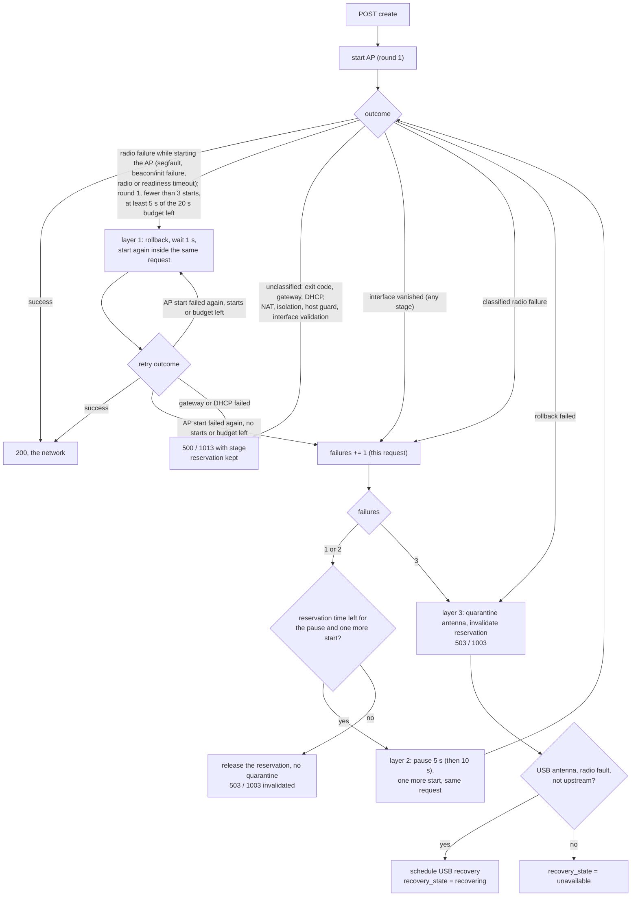

| Layer | Where | Trigger | Limit |
|---|---|---|---|
| 1. Internal retry | Inside one request (`NetworkManager`) | Radio failure while starting the AP, on either band: hostapd segfault, beacon setup and interface initialization failure (`HostapdInitFailure`), radio preparation or readiness timeout. First round of the request only. | Up to 3 starts, 1 s apart, within 20 s from the request start, capped by expiry. A start begins only with at least 4 s left (`MIN_RETRY_ATTEMPT_TIME`, Fable HAP-4), so a start cut short by the budget never counts as a radio failure. If the last start fails, the round counts as **one** radio failure. |
| 2. Paused retry | Same request (route, `CREATE_RETRY_DELAYS`) | Classified radio failure of a round | 3 rounds per request, pauses 5 s and 10 s, each only if the reservation has time for the pause plus one start (`AP_READY_TIMEOUT` or `DFS_READY_TIMEOUT`, plus `START_MARGIN`). The device lock is held during the pauses: other calls on the reservation get `503 / 1006`. |
| 3. Quarantine and USB recovery | Background worker | 3rd classified failure, unsafe rollback, or a failed watchdog restart | 10 rounds at least 60 s apart, USB antennas only. Then, and for every other quarantine, a periodic re-probe ([8.1](#81-re-probe-of-unavailable-antennas)). |

Layer 1 exists because these failures are short-lived: in test runs nearly
every one succeeded on an immediate new start. Layer 2 used to be the client's
job (`409 / 1001` with `Retry-After` 5 and 10 s, then the same create again);
the server now takes the same pauses inside the request, so the client sends
one create and gets `200` or a terminal `503 / 1003`. A start without failures
still takes about 0.5 s; one internal retry adds about 2–3 s, two about
5–6 s; with every layer-2 round the worst case is about 80 s outside DFS
channels. Gateway, DHCP, captive portal, NAT, isolation and other
unclassified failures are not retried. The classification belongs to the
exception, not to the attempt (Fable HAP-3): a radio failure is radio in every
round and in a watchdog restart, and an unclassified hostapd exit on the
internal retry of a request that already had a radio failure stays radio. On a
DFS channel the radar check can use up the whole layer-1 budget, so a failure
there goes straight to layer 2.

An unclassified startup failure with successful rollback returns `500 / 1013`
with the failed `stage`. It does not count as a radio failure, but the
reservation still holds the antenna. `release_device()` in the rollback cleans
up the network; it does not delete the reservation. The client can release the
ID explicitly when it no longer needs it.

An interface that is missing after a failed start, or at interface
validation, is a **radio failure** whatever hostapd reported: the adapter
disconnected under it. It is not retried in layer 1 (nothing can start until
the adapter re-enumerates), but the layer-2 pauses give it time to come back.
If it is still missing in the third round, the antenna is quarantined with a
radio fault, which allows USB recovery.

Do not classify an isolated hostapd exit code `1` as a radio failure based on
the exit code alone: that would also make persistent non-radio failures eligible
for quarantine after three attempts. A more specific transient failure signal
would be needed before routing these exits through the layer-2 path.

### 6.1 End-to-end sequence (server view)

The same flow as the client diagram in
[AP creation procedure, 3](ap-creation-procedure.md#3-sequence-diagram), seen
from inside: which component decides each answer, which lock is held, and
which background loop acts on its own. `RM` is the `ReservationManager` (one
lock per device), `NM` the `NetworkManager` (device lock, firewall lock), `CM`
the `ChannelManager` (cached `iw` reading), `H` the hostapd child process,
`FW` dnsmasq, gateway and iptables (NAT, isolation, host guard, captive
portal), `WD` the per-antenna watchdog thread, `EX` the expiry loop.

```mermaid
sequenceDiagram
    autonumber
    participant C as Client
    participant A as API routes
    participant RM as ReservationManager
    participant NM as NetworkManager
    participant CM as ChannelManager
    participant H as hostapd
    participant FW as dnsmasq and iptables
    participant WD as Watchdog (per antenna)
    participant EX as Expiry loop

    rect rgba(128,128,128,0.08)
    Note over C,EX: Reserve
    C->>A: POST /reservations {duration_seconds}
    A->>A: duration vs min_timeout, max_timeout, allow_unlimited_reservation
    alt invalid
        A-->>C: 422
    end
    A->>RM: create(duration)
    RM->>RM: purge expired reservations (their cleanup runs here, under the device lock)
    Note over RM: a failed cleanup keeps its antenna held (retried with backoff),<br/>it counts as reserved below
    alt first discovered antenna that is free and not quarantined
        RM-->>A: Reservation(id, device, expires_at)
        A-->>C: 200 reservation_id, interface, expires_at, expires_in
    else every antenna reserved (or held by a failed cleanup)
        A-->>C: 409 / 1005 next_available_at, next_available_in (expiry or next cleanup)
    else none allocatable, a USB recovery is running
        A-->>C: 503 / 1002 Retry-After 10
    else none allocatable, nothing recovering (or none discovered yet)
        A-->>C: 503 / 1003
    end
    end

    rect rgba(128,128,128,0.08)
    Note over C,EX: Antenna options (no reservation)
    C->>A: GET /antennas/{interface}
    A->>CM: get_channels(interface)
    CM->>CM: cached, else iw phy channels and iw phy info (6 GHz dropped,<br/>DFS disabled when antennas[].show_dfs is false)
    alt read fails
        A-->>C: 503
    else
        A->>A: band_options(): same rules as validate_network
        A-->>C: 200 device, encryptions, bands
    end
    end

    rect rgba(128,128,128,0.08)
    Note over C,EX: Create (POST /reservations/{id}/network)
    C->>A: body {radio, wifi, internet, captive_portal}
    A->>A: NetworkCreateBody to flat request, field rules (FieldError keeps the path)
    alt body invalid
        A-->>C: 422 "radio.channel_width: ..."
    end
    A->>RM: resolve id
    alt unknown, expired, released or invalidated
        A-->>C: 404
    end
    alt watchdog state restoring_ap or restoring_dhcp
        A-->>C: 409 "Network restoration is in progress"
    end
    A->>RM: hold the reservation, waiting for the device lock (no 1006 on create)
    A->>CM: validate_network(band, channel, width, generation, encryption)
    alt refused (refused again after one fresh iw reading)
        A-->>C: 422 "radio.channel: ..." or "radio.channel_width: ..."
    end
    loop Layer 2: up to 3 rounds, pauses 5 s and 10 s (device lock held)
    A->>NM: start_network(device, request, allow_internal_retry = round 1)
    alt network already in active
        NM-->>A: ValueError already active
        A-->>C: 409 "already active"
    end
    NM->>NM: release_device(): remove leftovers of an earlier start
    alt leftover cleanup fails
        NM->>RM: quarantine the antenna, invalidate the reservation
        A-->>C: 503 / 1003 reservation_invalidated true
    end
    loop Layer 1: up to 3 starts within 20 s (round 1 only)
        NM->>NM: subnet, interface validation, NetworkManager unmanaged
        NM->>H: ip link down, iw set type managed, hostapd -d hostapd.conf
        H-->>NM: output events, control socket, state ENABLED (timeout 20 s, 75 s on DFS)
        alt radio failure (segfault, beacon or init failure, readiness timeout)
            NM->>NM: report in hostapd_debug_dir if set, rollback, wait 1 s, start again
        end
    end
    alt AP ready
        NM->>FW: gateway IP, dnsmasq, NAT (if internet), isolation, host guard, captive portal
        alt one of them fails
            NM->>NM: rollback the whole network
            A-->>C: 500 / 1013 with stage, reservation kept
        else all installed
            NM->>NM: TX power (unsupported: one warning), active[device] = status
            A-->>C: 200 the network (as GET .../network)
        end
    else classified radio failure after layer 1
        NM->>NM: rollback, failures += 1
        alt failures 1 or 2, time left for the pause and one start
            A->>A: pause 5 s (then 10 s), next round
        else failures 1 or 2, reservation expires too soon
            A->>RM: release the reservation (no quarantine)
            A-->>C: 503 / 1003 reservation_invalidated true
        else failures 3, or the rollback failed
            NM->>RM: quarantine the antenna, invalidate the reservation
            A-->>C: 503 / 1003 reservation_invalidated true
            Note over RM: USB antenna: reset and probe (recovering)<br/>otherwise periodic re-probe (unavailable)
        end
    else unclassified failure (hostapd exit code, interface validation)
        NM->>NM: rollback
        A-->>C: 500 / 1013 with stage, reservation kept
    end
    end
    end

    rect rgba(128,128,128,0.08)
    Note over C,EX: While the AP runs
    loop Every 5 s, only when the device lock is free
        WD->>NM: active network? stop_failed? reservation valid?
        alt stop_failed (a stop did not complete)
            WD->>WD: leave it alone (repairing would undo the client's stop)
        else hostapd dead or not ENABLED 3 times
            WD->>WD: runtime_state restoring_ap (budget 3 per hour per antenna)
            WD->>NM: restart the network with the same request
            alt restart fails, radio fault, or 4th failure in the hour
                WD->>RM: quarantine, invalidate (the owner then gets 404)
            else restart fails for another reason
                WD->>WD: restore_failed, retry after 15, 30, 60, 120 s, then every 5 min
            end
        else dnsmasq dead
            WD->>FW: restart dnsmasq (restoring_dhcp), after 3 in an hour restart the network
        else every 30 s (6 healthy ticks)
            WD->>FW: verify gateway, ip_forward, NAT, Internet block, isolation, captive portal, re-add missing rules
        end
    end
    C->>A: GET .../network, Internet, TX power, QoS (any call with an id except create)
    A->>RM: hold the reservation, wait at most 5 s for the device lock
    alt lock still held after 5 s (a start or restore is running)
        A-->>C: 503 / 1006 Retry-After 2 (nothing changed)
    else no running network (Internet, TX power, QoS)
        A-->>C: 409 / 1007
    else
        A-->>C: 200 (GET adds runtime_state from WD, or stop_failed from NM)
    end
    end

    rect rgba(128,128,128,0.08)
    Note over C,EX: Stop (DELETE /reservations/{id}/network)
    C->>A: DELETE .../network
    A->>NM: stop_network(device) under the device lock
    NM->>H: SIGTERM, after 2 s SIGKILL, wait 2 s more
    alt hostapd stuck in the kernel (driver firmware timeout)
        NM->>FW: remove the rest (QoS, captive portal, host guard, isolation, DHCP)
        NM->>NM: keep the network in active, mark stop_failed
        loop every 2 s, up to 15 s
            A->>NM: stop_network again
        end
        A-->>C: 503 / 1012 stop_incomplete, Retry-After 5 (still stuck after 15 s)
        C->>A: DELETE .../network again after Retry-After
        A->>NM: stop_network: hostapd has exited, NAT released
        A-->>C: 200
    else
        NM->>FW: release NAT, captive portal, host guard, isolation, DHCP
        A-->>C: 200
    end
    end

    rect rgba(128,128,128,0.08)
    Note over C,EX: Release and expiry
    C->>A: DELETE /reservations/{id}
    A->>RM: delete: release_requests += 1, device lock
    RM->>NM: release_device(): tracked stop of everything still running
    alt stop fails
        NM->>NM: cleanup backoff 5, 15, 60, 300 s
        RM->>RM: expire the reservation now: ID gone, antenna held
        A-->>C: 200 (the expiry loop repeats the cleanup, /status: cleanup_failed)
    else
        A-->>C: 200
    end
    loop Every 5 s
        EX->>RM: expired reservations whose cleanup is due
        RM->>NM: release_device()
        alt cleanup fails
            NM->>NM: next attempt after the backoff, device stays held
        else
            RM->>RM: antenna free again
        end
    end
    end
```

## 7. After start: watchdog

Each antenna has a watchdog thread that wakes up every 5 seconds.

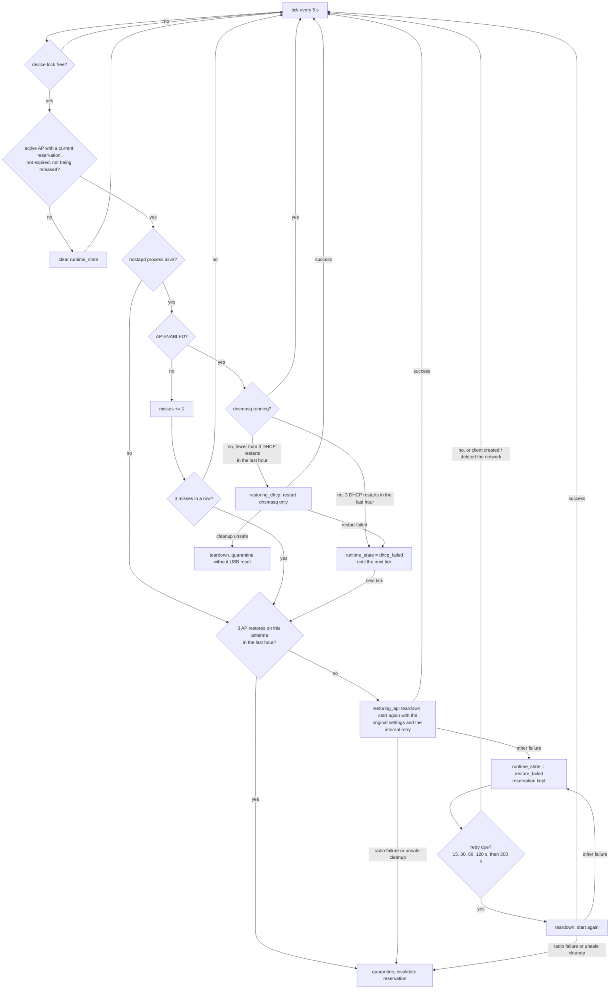

- No connected stations is not a failure.
- **Restore budget (WD-1):** an antenna can have its AP restored up to 3 times in
  any hour (`RESTORE_LIMIT`, `RESTORE_WINDOW`). A further failure inside that
  hour quarantines it. The budget belongs to the antenna, not to the network:
  deleting and recreating the network does not reset it. A long-lived
  reservation can therefore survive one outage a day indefinitely, while an AP
  that keeps dying is taken out of the pool.
- **Network check (WD-7):** every 6th tick (30 s) of a healthy network, the
  watchdog checks what the network needs beyond its processes and repairs it
  in place, logging a `WARNING` with what was lost: the gateway address on
  the interface (then dnsmasq is restarted), `net.ipv4.ip_forward`, the NAT
  rules (`internet_enabled: true`) or the Internet block rules
  (`internet_enabled: false`, reinstalled in order), and the isolation rules
  between AP subnets. A host firewall reload (firewalld, ufw, Docker) or an
  administrator can remove them. If the captive portal server or its rules
  are gone, the whole network is restored instead, through the AP restore
  budget. Whether the radio really transmits (beacons) is not checked yet.
- **DHCP repair (WD-3):** a dead dnsmasq is restarted alone, keeping the AP
  up, up to 3 times in any hour per antenna (`DHCP_RESTORE_LIMIT`, same
  window). If a DHCP restart fails, or dnsmasq dies a fourth time within the
  hour, the next tick restores the whole network, which goes through the AP
  restore budget above. `dhcp_failed` is visible only in the 5 s between the
  two ticks.
- **Failed restore (WD-2):** a restart that fails for a non-radio reason is
  not silent. `runtime_state` becomes `restore_failed` (so `/status` is
  `degraded`) and the watchdog retries with backoff (`RETRY_BACKOFF`: 15, 30,
  60, 120 s, then every 300 s) while the reservation is valid. Retries stop
  when a retry succeeds, the reservation is released, expires or is
  quarantined, or the client creates a network (`POST`) or gives it up
  (`DELETE .../network` returns `200` and keeps the reservation). A radio
  failure or unsafe cleanup during a retry quarantines as usual. Retries do
  not count against the restore budget.
- The restart keeps the reservation and its expiry. Clients must reconnect; QoS
  is cleared by the teardown and must be reapplied.
- Every AP restore and DHCP-only restart is counted on the `Reservation`
  (`ap_restarts`, `dhcp_restarts`, last time and reason) when it begins,
  whether it succeeds or not. `GET .../network` shows them in `restarts`; the
  counters never decrease during the reservation, so a client compares them
  before and after a test. In-place repairs that do not interrupt the AP
  (gateway address, rules) are not counted.
- Release or expiry cancels a pending restart. If a restart already ran, its
  result is cleaned up under the device lock before the antenna can be reused.
- `POST create` returns `409` while `restoring_ap` or `restoring_dhcp` is set.

## 8. Quarantine and automatic USB recovery

A quarantined antenna is excluded from allocation. If it is a USB adapter
(detected from sysfs at discovery), the failure was a radio fault and it is not
the upstream interface, Wi-Lab starts a recovery worker for it.

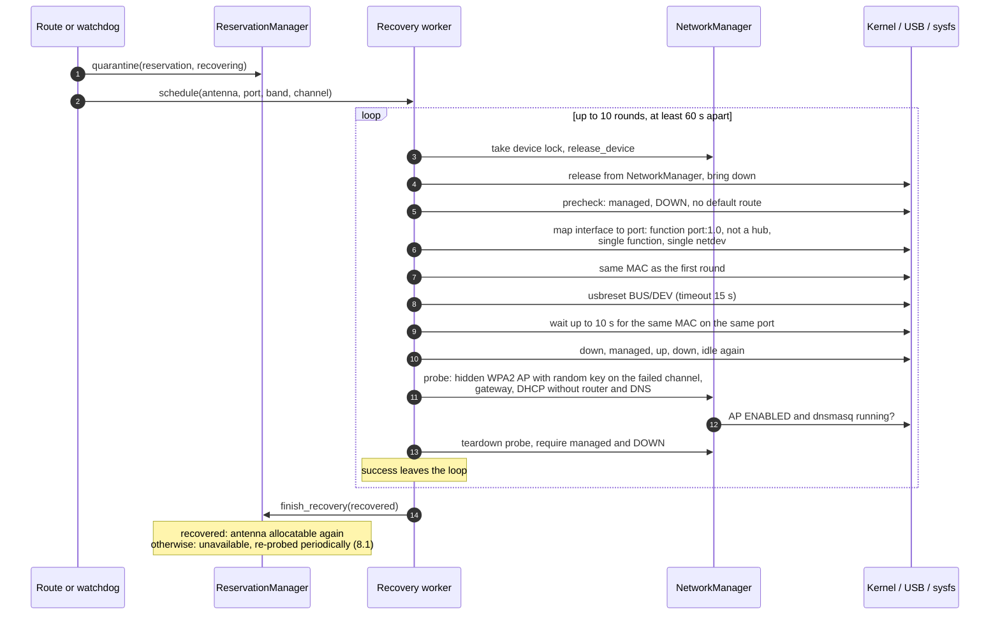

- A failed precheck skips the reset for that round.
- After a USB reset the adapter is a new device. NetworkManager or
  systemd-networkd could bring it up, so the worker releases it from
  NetworkManager and brings it down again before each check. See
  [section 10](#10-host-state-and-files) for how both managers are kept away.
- The probe is a server-side check only: it does not prove that a real station
  can associate and get a lease.
- Other antennas stay fully available during recovery.
- For hardware that does not recover, use the
  [manual recovery procedure](#82-manual-recovery).

### 8.1 Re-probe of unavailable antennas

An antenna becomes `unavailable` when it is quarantined without USB recovery
(non-USB adapter, non-radio fault, failed cleanup, upstream interface) or when
USB recovery used its 10 rounds. The `unavailable-reprobe` thread checks every
5 s and probes each such antenna with backoff: first attempt 30 s after it
became unavailable, then 60 s, 120 s, 300 s, 600 s and every 900 s.

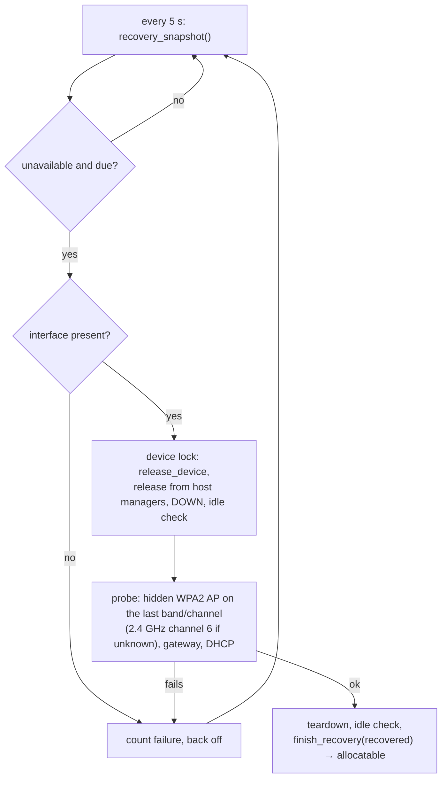

- No USB reset is performed: the re-probe only verifies. A radio that needs a
  reset and has exhausted USB recovery stays unavailable.
- The upstream interface is never probed (`_quiesce` refuses it).
- Antennas being recovered (`recovering`) are left to the USB worker.
- Logs: `Adapter X passed the probe and is allocatable again` (warning) or
  `Adapter X still unavailable after re-probe N; next attempt in S s` (info).

### 8.2 Manual recovery

Use it when automatic recovery was not possible (non-USB adapter, refused
target, upstream interface) or exhausted its attempts (`recovery_state:
unavailable`) and the periodic re-probe keeps failing. It resets **one USB
device**, never a hub or the controller. A successful reset does not establish
or fix the underlying cause. Quarantine is in memory: a service restart clears
it but does not repair the adapter. If the adapter is no longer on the USB bus
at all (`lsusb` does not list it), it must be re-attached (replug, or re-attach
the USB passthrough to the VM) before any recovery can work.

Observed case: a MediaTek `mt7921u` adapter in a KVM guest whose interface
could not be brought up (`RTNETLINK answers: Connection timed out`) was restored
by a targeted USB reset. This is an observation, not a guarantee for other
hardware.

**Before starting**

- Stopping Wi-Lab affects every adapter. Agree a maintenance window and check
  `GET /api/v2/status`: no reservations and no active networks. Ask owners to
  release theirs; do not use `DELETE /api/v2/reservations/all`.
- Check that nothing outside Wi-Lab uses the adapter, and that it is neither the
  management nor the upstream interface (`ip -br link`, `ip route show default`,
  `iw dev`). Keep console access (for example KVM) in case the management
  connection is lost.
- Do not share tokens, reservation IDs, WPA passwords, configuration files or
  unredacted logs. `/tmp/wilab-hostapd/` may contain a passphrase.

**Procedure** (the interface name is an example):

```sh
IFACE=wlx001122334455
journalctl -u wi-lab.service --since '15 minutes ago' --no-pager   # failure context
sudo journalctl -k --since '15 minutes ago' --no-pager             # USB, firmware, segfaults

sudo systemctl stop wi-lab.service

# Map the interface to exactly one USB device; stop if anything is ambiguous.
USB_DEVICE=$(dirname "$(readlink -f "/sys/class/net/$IFACE/device")")
cat "$USB_DEVICE"/{idVendor,idProduct,busnum,devnum}; lsusb -t
BUS=$(cat "$USB_DEVICE/busnum"); DEVICE=$(cat "$USB_DEVICE/devnum")   # read right before the reset
sudo usbreset "$(printf '%03d/%03d' "$BUS" "$DEVICE")"

# Verify: same name, driver bound, link can go up and back down.
ip -br link; iw dev; sudo journalctl -k --since '2 minutes ago' --no-pager
sudo timeout 15s ip link set dev "$IFACE" up && sudo timeout 15s ip link set dev "$IFACE" down

sudo systemctl start wi-lab.service
```

- Select the device by bus/device number, never by vendor/product ID: identical
  adapters share them. Bus/device numbers change after a reconnection.
- While Wi-Lab is stopped, its rule in `/run` still keeps systemd-networkd away
  from the adapter (until reboot). NetworkManager may take a re-enumerated
  adapter again: before testing the link run
  `sudo nmcli device set "$IFACE" managed no`. The interface keeps its
  `wlx<MAC>` name; if it comes back with another name, discovery adds it as a
  new antenna.
- If bringing the link up still times out, the adapter is not recovered: start
  Wi-Lab anyway (other adapters keep working) and escalate.
- Validate with Wi-Lab: reserve the adapter, create a temporary WPA2 network,
  connect an external client (association and DHCP), then release. An API or
  `iw` check alone does not prove that clients can connect.

If it fails again, record interface, USB topology, driver, firmware, kernel and
`hostapd` versions; on a VM compare with the physical host and review USB
passthrough and power. Do not reset the shared controller, reload shared
driver modules or retry in a loop.

## 9. Expiry and shutdown

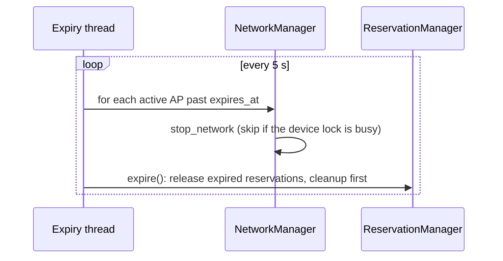

On shutdown (`SIGTERM` from systemd) the lifespan stops device discovery, waits
briefly for it and calls `shutdown_all()`: it stops the recovery
worker and the watchdogs, then runs `release_device()` for every antenna so that
no hostapd, dnsmasq, iptables or tc state is left behind.

## 10. Host state and files

| State | Location | Lifetime |
|---|---|---|
| Reservations, quarantine, active networks, watchdog states | Process memory | Lost on restart. |
| hostapd configuration and control socket | `/tmp/wilab-hostapd/ap-*/` | Removed at teardown. Contains the WPA passphrase. |
| dnsmasq configuration, leases, PID | `/tmp/wilab-dnsmasq/` | Removed at teardown. If a launch timed out before the PID file existed, teardown finds the daemon by its unique `--conf-file` argument in `/proc`, or concludes none was started (Fable NET-6). |
| NAT and isolation rules | iptables `nat` and `FORWARD` | Removed at teardown. Leftovers are reported at startup. |
| Captive portal chains and sign-ins | iptables `wilab-cp-<interface>` chains; sign-ins in process memory | Removed at teardown and at startup. |
| Traffic shaping | tc qdiscs, IFB devices | Removed at teardown. |
| Host network manager exclusion | NetworkManager runtime device state; `/run/systemd/network/00-wilab-unmanaged.network` | Applied when antennas are added; cleared on reboot. |

When discovery adds antennas, Wi-Lab keeps the host's network managers away
from **only those interfaces**. Otherwise they bring Wi-Lab radios up after a
reboot or a USB reset and start wpa_supplicant or DHCP on them.

- **NetworkManager:** `nmcli device set <radio> managed no` for each radio.
  Wi-Lab never writes NetworkManager configuration or reloads it: a reload
  re-reads the settings of every interface, and a wrong rule once handed the
  management interface to NetworkManager, which obtained a different DHCP
  address. A radio that re-enumerates is new to NetworkManager; the recovery
  worker releases it again, and so does every AP start.
- **systemd-networkd:** a rule matching only the radios' names sets
  `Unmanaged=yes`. `networkctl reload` reconfigures only links whose matching
  configuration changed, so other interfaces are not touched.

Recommended host setup: the Wi-Lab host should not use Wi-Fi for its own
connectivity, and every Wi-Fi adapter on it should belong to Wi-Lab. Keep any
other Wi-Fi adapter out with `disable: true` (see
[Antenna detection](#antenna-detection)).

With `upstream_interface: auto` the upstream interface is resolved from the
default route on every use (Fable STAB-6), so a route that moves (cable on
another port, VPN, failover) is followed: a new network uses the new interface,
and within 30 s the watchdog network check (WD-7) moves the NAT rules of running
networks, logging "NAT upstream <old> -> <new>". A change of the default route
is logged once as a warning. Set `upstream_interface` to force an interface.

## 11. Observability

- Every API `5xx` logs `API failure operation=<route> http_status=<code>
  detail_code=<code>` without IDs, tokens or bodies:
  `journalctl -u wi-lab.service -g 'API failure operation='`.
- Discovery logs every added antenna with its USB port (or `non-USB`) and
  subnet. The first scan also logs skipped interfaces with the reason.
- `GET /api/v2/status` exposes `runtime_state` (watchdog) and `recovery_state`
  (quarantine) per antenna; `GET /api/v2/monitoring` the detail of every
  health check.

## 12. Known limitations

- **A command stuck in the kernel is reported, not fixed.** A hung Wi-Fi
  driver can leave `ip`, `iw` or `usbreset` in an uninterruptible kernel call
  where even SIGKILL does not end it. Wi-Lab kills every command at its timeout
  and stops waiting `KILL_GRACE` (2 s) after the SIGKILL (Fable STAB-1): the
  caller gets `CommandStuck` (a `CommandTimeout`), so the operation fails and
  releases the device lock instead of blocking the thread, the lock and the API
  forever. The process is logged at `CRITICAL`, counted in
  `GET /api/v2/monitoring` → `checks.commands.stuck`, and makes the service
  `degraded` until it exits. The process, and any kernel lock it holds, stays;
  other commands may then time out too. Recovering the adapter can require
  unplugging it or rebooting the VM or host, which is the maintainer's call:
  a stuck command never makes Wi-Lab restart itself, because a new process
  would hang on the same kernel lock.
- **Self-restart only when idle (STAB-1).** The unit is `Type=notify` with
  `WatchdogSec=90s`. Every background loop (`expiry`, `discovery`,
  `reprobe`, `watchdog:<interface>`) records a heartbeat per iteration
  (`wilab/heartbeat.py`), and a thread pings systemd every 20 s. If a loop
  has not run for 3 minutes, `/monitoring` lists it in `checks.loops.stale` and
  `/status` is `degraded` (`loop_stalled`). The pings stop, so systemd restarts the service, only while
  no reservation is valid and no USB recovery is running (read without
  locks, so a stalled lock holder cannot block the check). With a
  reservation active the service keeps running and restarts as soon as it
  is idle. Only the Wi-Lab service restarts, never the machine. Restarts
  count towards the unit's start limit.
- Antennas are added at runtime but never removed: an antenna unplugged while in
  the pool stays listed (as `unavailable` once it fails) until the service
  restarts. A returning adapter keeps its `wlx<MAC>` name and is re-probed; one
  that comes back under a different name is added as a new antenna and the old
  entry stays listed (Fable WD-5, point 3, depends on ARCH-4).
- All coordination state is in memory and assumes a single Wi-Lab process per
  host.
